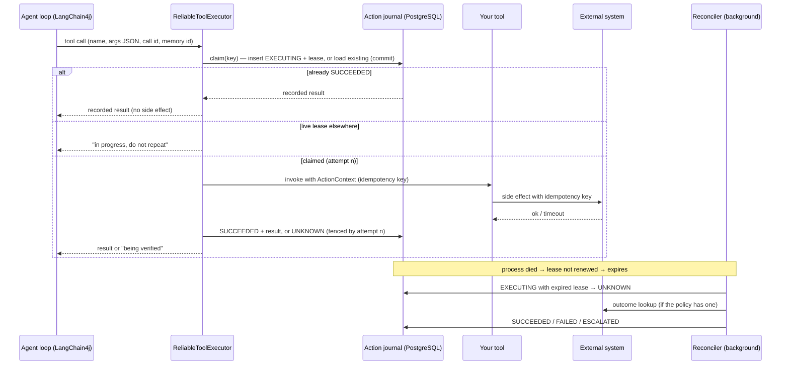

# reliable-agent-actions

> **Status: 0.1.0 is on Maven Central** (`io.github.oleksii-fenin`, 2026-11-26). Core, the PostgreSQL journal, the
> reconciler with retention, the operator API, the LangChain4j adapter with chat-memory repair (tested on 1.14.0 and
> 1.23.0), OpenTelemetry spans and metrics, and the kill, pause and database-fault tests. The artifacts are signed with
> the key `8D4F33BE3631C885FC1FD4B93B38FDCE92C5089E` ([`docs/RELEASING.md`](docs/RELEASING.md)). See the verification
> status below the guarantees and `examples/langchain4j-refund`. Working name — see
> [`docs/OPEN-QUESTIONS.md`](docs/OPEN-QUESTIONS.md).

A small Java library that makes **side-effecting tool calls of AI agents effectively-once**. Your agent's
"refund the order", "send the e-mail", "create the ticket" takes effect **once per logical action** — when the external
system deduplicates by key or can be asked what happened (see the guarantees below for the exact conditions) — even when
the process dies in the middle of a tool call, the downstream call times out, or the model re-issues the call after a
restart — and when the library *cannot* know whether it happened, it says so instead of guessing.

No extra server: one table in the PostgreSQL you already run, a decorator around your LangChain4j tools, and an
explicit policy per tool.

## The failure this prevents

1. The model asks for `refundOrder(orderId=42, amount=30)`.
2. Your tool calls the payment API. The refund succeeds.
3. The JVM is killed (deploy, OOM, node drain) **before** the tool result is written to chat memory.
   LangChain4j stores the assistant's tool request *before* running tools and the results *after* them, so the
   persistent memory now holds a tool call with no result.
4. After restart, either the conversation is retried and the model asks for the refund again — **with a new
   tool-call id** — or the stored history is sent as is and the provider rejects it. Nobody knows whether the refund
   happened.
5. The customer is refunded twice, or support has to check by hand.

HTTP-client retries do not help (the duplicate comes from the model). The provider's tool-call id does not help (it
changes on regeneration). Durable-execution engines checkpoint *completed* steps but re-run a step that crashed
mid-flight. What helps is a durable record of the **logical** action, written before the side effect, keyed by business
meaning, and an explicit rule for what to do when the outcome is unknown.

## Guarantees and non-guarantees

| Guaranteed (when configured as documented) | **Not** guaranteed |
|---|---|
| For one action key, at most one attempt holds a live lease, and only the current attempt can change the journal (unique key + lease + fencing token; the token includes the row's creation time, so it also holds after retention deleted a row and the key was used again, [ADR-0007](docs/adr/0007-fencing-token-includes-the-row-generation.md)) | Stopping a *paused* stale attempt from reaching the external system — only a downstream idempotency key prevents that duplicate; hence `IDEMPOTENT_DOWNSTREAM` for anything that matters |
| | Exactly-once against a system that offers neither an idempotency key nor an outcome lookup — impossible in general; such tools must choose `AT_MOST_ONCE` or `AT_LEAST_ONCE` |
| A succeeded action is never re-executed; a repeated call returns the **recorded result**; the same key with different material arguments returns an explicit conflict | Deduplication when the model changes the arguments the key is built from — that is a different action by design |
| An unknown outcome (crash, timeout) is never retried silently: it becomes `UNKNOWN` and is resolved only as the tool's policy allows | `RECONCILABLE` tools: a process paused longer than its lease *before* its request lands can still cause a duplicate after a "not found" lookup. Use `IDEMPOTENT_DOWNSTREAM` for money |
| Every action has a deadline and every attempt a maximum effect duration; after the deadline no new attempt starts, and an unresolved outcome is **escalated** — never reported as "not done", except when a declared outcome lookup said "not found" (the `RECONCILABLE` assumption below) | Ordering between different actions; multi-step workflows, timers, compensation — use Temporal / Restate / DBOS |
| Lease and deadline decisions use database time, not JVM clocks | Availability while the journal DB is down: side-effecting tools **fail closed** |
| Opt-in repair of LangChain4j chat memory from the journal after a crash | Replay after the retention period (default 7 days) — the row is gone |
| | Durability across a failover to an **asynchronous** replica that lost committed rows — use synchronous replication for the journal |
| | Automatic completion without the agent: the library never re-runs a tool by itself; an unknown outcome nobody asks about again is escalated at its deadline |
| | Unattended lookups without key text: the reconciler can look up only actions whose key is stored as text (`storeKeyText(true)`, which puts business identifiers such as order ids into the journal); otherwise the next call looks the outcome up, or it is escalated at its deadline ([ADR-0004](docs/adr/0004-reconciler-lookups-need-the-action-key.md)) |

Every row on the left is backed by automated tests, including a test that **kills the JVM in the middle of a tool
call**, one that **pauses** it past its lease, and negative controls proving the harness detects duplicates:

| Guarantee | Tests |
|---|---|
| One live lease per key; only the current attempt changes the journal, also after retention reused the key | [`ActionJournalTck`](raa-journal-tck/src/main/java/io/github/oleksiifenin/raa/tck/ActionJournalTck.java) (claim locking, fenced record writes, lease renewal and expiry, a re-created row), [`ConcurrentClaimTest`](raa-postgres/src/test/java/io/github/oleksiifenin/raa/postgres/ConcurrentClaimTest.java), [`TwoJvmConcurrencyTest`](raa-postgres/src/test/java/io/github/oleksiifenin/raa/postgres/TwoJvmConcurrencyTest.java), [`PauseTest`](raa-postgres/src/test/java/io/github/oleksiifenin/raa/postgres/PauseTest.java) |
| A succeeded action is never re-executed; the recorded result on repeat; a conflict on changed material arguments | [`ActionRunnerTest`](raa-core/src/test/java/io/github/oleksiifenin/raa/core/ActionRunnerTest.java), [`DecisionTableTest`](raa-core/src/test/java/io/github/oleksiifenin/raa/core/DecisionTableTest.java), [`KillMatrixTest`](raa-postgres/src/test/java/io/github/oleksiifenin/raa/postgres/KillMatrixTest.java), [`LangChain4jContractTest`](raa-langchain4j/src/test/java/io/github/oleksiifenin/raa/langchain4j/LangChain4jContractTest.java) |
| An unknown outcome is never retried silently | [`DecisionTableTest`](raa-core/src/test/java/io/github/oleksiifenin/raa/core/DecisionTableTest.java), [`ReconcilerTest`](raa-core/src/test/java/io/github/oleksiifenin/raa/core/ReconcilerTest.java), [`PostgresReconcilerTest`](raa-postgres/src/test/java/io/github/oleksiifenin/raa/postgres/PostgresReconcilerTest.java), [`KillMatrixTest`](raa-postgres/src/test/java/io/github/oleksiifenin/raa/postgres/KillMatrixTest.java), [`RandomizedKillTest`](raa-postgres/src/test/java/io/github/oleksiifenin/raa/postgres/RandomizedKillTest.java), [`LangChain4jKillMatrixTest`](examples/langchain4j-refund/src/test/java/io/github/oleksiifenin/raa/examples/refund/LangChain4jKillMatrixTest.java) |
| Deadline and maximum effect duration; escalation instead of "not done" | [`DecisionTableTest`](raa-core/src/test/java/io/github/oleksiifenin/raa/core/DecisionTableTest.java), [`ReconcilerTest`](raa-core/src/test/java/io/github/oleksiifenin/raa/core/ReconcilerTest.java), [`PostgresReconcilerTest`](raa-postgres/src/test/java/io/github/oleksiifenin/raa/postgres/PostgresReconcilerTest.java), [`PostgresActionRunnerTest`](raa-postgres/src/test/java/io/github/oleksiifenin/raa/postgres/PostgresActionRunnerTest.java) |
| Lease and deadline decisions use database time | [`DatabaseClockSkewTest`](raa-postgres/src/test/java/io/github/oleksiifenin/raa/postgres/DatabaseClockSkewTest.java) (the journal database's clock one hour ahead of the JVM clock and one hour behind it: lease, renewal, deadline, lookup window, lookup backoff and the reconciler decide as with the clocks in sync, and the journal TCK passes; scope and limits in DESIGN §13) |
| Repair of LangChain4j chat memory from the journal | [`JournalChatMemoryRepairTest`](raa-langchain4j/src/test/java/io/github/oleksiifenin/raa/langchain4j/JournalChatMemoryRepairTest.java), [`LangChain4jKillMatrixTest`](examples/langchain4j-refund/src/test/java/io/github/oleksiifenin/raa/examples/refund/LangChain4jKillMatrixTest.java) (mode (b)) |

**Verification status (2026-11-23, PostgreSQL 14 and 18):**

* **Verified — process kill.** A child JVM is killed with SIGKILL at four points of a tool call (after the claim; effect
  applied with the response held; response received but not recorded; recorded but not handed back) and a second JVM
  calls again with a new tool-call id. For all four policies the effects applied, the final journal state and the final
  outcome match the expected-outcome table ([`KillMatrixTest`](raa-postgres/src/test/java/io/github/oleksiifenin/raa/postgres/KillMatrixTest.java), DESIGN §9.1, mode (a)). Negative controls without
  the library see the duplicate effect, so the harness can detect one.
* **Verified — journal rules.** One live lease per key and fenced writes of stale attempts (journal TCK on PostgreSQL),
  the recorded result on repeat and the conflict on changed arguments, unknown outcomes never retried silently,
  deadlines and escalation (runner, reconciler and decision-table tests). The lease and deadline decisions stay the
  same with the database clock an hour ahead of the JVM clock or an hour behind it.
* **Verified — LangChain4j adapter** through a real `AiServices` with a scripted model, on LangChain4j 1.14.0 and
  1.23.0: a tool runs once, a regenerated call or a call after lost memory gets the recorded result, a crash during the
  tool is retried with the same idempotency key, concurrent same-key calls run the tool once, invalid arguments and a
  missing `@MemoryId` are "not performed"; specifications and `ReturnBehavior` are kept, `IMMEDIATE` is rejected.
* **Verified — end to end through LangChain4j** (`examples/langchain4j-refund`): the refund agent, with its chat memory
  in PostgreSQL, is killed at the same four points and resumed either by retrying the conversation (mode (a)) or by
  repairing the memory from the journal and continuing (mode (b)); all 32 cells match the table, and in mode (b) the
  repaired answer itself is checked. Without the library the same agent refunds twice.
* **Verified — killed at a random moment** (nightly, 500 runs per policy; locally 25 per policy): the child is killed
  anywhere from just before the call to just after it, and every run ends as the expected-outcome table allows for its
  policy ([`RandomizedKillTest`](raa-postgres/src/test/java/io/github/oleksiifenin/raa/postgres/RandomizedKillTest.java)).
* **Verified — pause past the lease.** A child JVM is paused with SIGSTOP inside the effect (before its request is sent,
  or after the effect, before the record), its lease expires, a second JVM calls again, then the first is resumed
  ([`PauseTest`](raa-postgres/src/test/java/io/github/oleksiifenin/raa/postgres/PauseTest.java), DESIGN §2 Q1p). The
  paused attempt's late write changes nothing once a newer attempt exists or the row is already resolved by a lookup;
  `IDEMPOTENT_DOWNSTREAM` applies the effect once (the downstream deduplicates). The non-guarantees on the right are
  shown, not hidden: `AT_LEAST_ONCE` applies it twice, and `RECONCILABLE` does too when the paused request lands after
  a "not found" lookup.
* **Verified — two processes at once.** 32 threads in each of two JVMs call one action at the same moment with the
  downstream deduplicating nothing: one effect, every other call sees the attempt in progress, later calls get the
  recorded result ([`TwoJvmConcurrencyTest`](raa-postgres/src/test/java/io/github/oleksiifenin/raa/postgres/TwoJvmConcurrencyTest.java), Q2).
* **Verified — database faults** with Toxiproxy between the journal and PostgreSQL and the pool settings below
  ([`DatabaseFaultTest`](raa-postgres/src/test/java/io/github/oleksiifenin/raa/postgres/DatabaseFaultTest.java), Q6):
  a blackholed, stopped or unreachable database and an exhausted pool give `JournalUnavailable` within 3 s, the tool
  does not run and nothing is committed. A response lost at the claim's `COMMIT` is also `JournalUnavailable` without
  running the tool; the next call then follows the policy (an at-most-once action is escalated, never run). A lost
  response or request at the record's `COMMIT` is retried and the result recorded. Every journal operation ends within
  its timeout (2.5 s) while the database is silent, trickles its response or stops reading a large write.
* **Verified — observability** through the OpenTelemetry SDK with in-memory exporters: one `reliable_action` span
  per call (child of the current span, with policy, key hash, attempt and outcome; state transitions as events), the
  `execute_tool` span of the GenAI conventions around it, and the counters and journal-duration histogram; a telemetry
  that throws never changes an action. The gauge `raa.actions.unresolved` (`UNKNOWN` and `ESCALATED` actions of the
  whole journal, by `raa.state`) is set at the end of every reconciler run and keeps its last value while the journal
  cannot be counted, so alert on it together with journal errors; aggregate it across processes with the maximum, not
  the sum.
* **Verified — retention, operator API, redaction** on PostgreSQL and the in-memory journal
  ([`ActionJournalTck`](raa-journal-tck/src/main/java/io/github/oleksiifenin/raa/tck/ActionJournalTck.java)): every
  reconciler run deletes finished actions older than the retention (default 7 days), never an unresolved one;
  `ReliableActions.admin()` lists and counts actions by state and lets an operator resolve an escalated action as
  applied or not applied (compare-and-set, so a late result is never overwritten); `redact` erases the key text,
  arguments, result and error of an action (for example on a personal-data request) while the key stays deduplicated,
  and nothing written to that action later stores a text again. The model is then told that the action was performed
  and its result removed.
* **Measured — overhead and throughput** (`OverheadBenchmarkTest`, off by default; run it alone with
  `./gradlew :raa-postgres:test --tests '*OverheadBenchmarkTest*' -PoverheadActions=10000 --rerun`): a journaled first
  call whose effect does nothing, so its time is the added latency, on HikariCP (pool 10, the settings below) against
  PostgreSQL 18.6 in rootless Docker on the same laptop (Intel i7-8750H, 12 logical CPUs, Linux 6.8, Java 25,
  `synchronous_commit=on`, `fsync=on`; rootless Docker forwards the port in user space, which every round trip pays),
  10 000 measured actions per phase after 1 000 warm-up each, three runs on 2026-11-22:

  | | p50 | p99 | throughput |
  |---|---|---|---|
  | one thread (Q3, target p99 < 10 ms) | 5.1 ms | 8.2–8.3 ms | — |
  | 8 threads, closed loop at saturation (Q5, target ≥ 200/s) | 5.8–6.1 ms | 12.0–13.8 ms | 1 300–1 320 actions/s |
  | floor: a pooled one-row insert transaction | 1.5 ms | 2.1–2.2 ms | — |

  Two transactions of the floor's shape (claim and record each end in a durable commit) are about 60 % of the
  median; the rest is not broken down (the journal's transaction setup, the claim's reads and call history, wider
  rows and more indexes, the runtime). In the 8-thread phase each thread starts its next call when the previous one
  returns, so its latencies are those of a saturated pool, not of a given offered load. The numbers belong to this
  machine; a database across a network adds its round-trip time to every statement. A measurement, not a gate.
* **Argued, not verified yet:** failover behavior.

## Quick start

The artifacts are on Maven Central (`mavenCentral()` in the repositories). The BOM keeps the `raa-*` versions in line:

```kotlin
dependencies {
    implementation(platform("io.github.oleksii-fenin:raa-bom:0.1.0"))
    implementation("io.github.oleksii-fenin:raa-core")
    implementation("io.github.oleksii-fenin:raa-postgres")
    implementation("io.github.oleksii-fenin:raa-langchain4j")      // with your own dev.langchain4j:langchain4j ≥ 1.14.0
    implementation("io.github.oleksii-fenin:raa-opentelemetry")    // optional
    testImplementation("io.github.oleksii-fenin:raa-testkit")      // optional: kill tests of your own tools
}
```

In Maven, import `raa-bom` in `<dependencyManagement>` (`<type>pom</type>`, `<scope>import</scope>`) and declare the
modules without versions. The JARs are Java 17 bytecode with `Automatic-Module-Name` set to their package
(`io.github.oleksiifenin.raa.core`, …).

```java
// 1. Journal in your PostgreSQL (plain SQL migration shipped for Flyway/Liquibase). Every journal operation is
//    bounded by an operation timeout (default 2.5 s, ADR-0006); the pool must not wait longer (see below).
ActionJournal journal = PostgresActionJournal.create(dataSource);

// 2. Declare how each side-effecting tool is protected
ReliableActions actions = ReliableActions.builder(journal)
    .tool("refundOrder", ActionPolicy.idempotentDownstream(Duration.ofHours(24))   // payment API dedups by our key for 24 h
            .key((call, args) -> ActionKey.of(call.scope(), "refund", args.longValue("orderId")))
            .maxEffectDuration(Duration.ofSeconds(30))                            // ≥ the HTTP client timeout
            .deadline(Duration.ofMinutes(15)))
    .tool("sendEmail", ActionPolicy.reconcilable((key, idempotencyKey) -> mailer.findByReference(idempotencyKey))
            .key((call, args) -> ActionKey.of(call.scope(), "email", args.string("ticketId")))
            .freeTextArguments("body")                                            // regenerated text is not a new action
            .maxEffectDuration(Duration.ofSeconds(20)))
    .tool("getOrder", ActionPolicy.none())                                          // read-only, not journaled
    .storeKeyText(true)          // lets the reconciler look up sendEmail on its own; stores business ids (ADR-0004)
    .build();

// 3. Wrap tools for LangChain4j — tool code stays as it is. The AI service method needs @MemoryId: the memory id is
//    the scope of every action key, and without it the journaled tools are not performed (ADR-0005).
ReliableTools reliableTools = ReliableTools.builder(actions).build();
List<AiServiceTool> tools = reliableTools.wrap(new BillingTools());
Assistant assistant = AiServices.builder(Assistant.class)
    .chatModel(model)
    .chatMemoryProvider(memoryProvider)
    .tools(tools)
    .build();

// Inside a tool, pass the stable key downstream:
@Tool("Refund an order")
String refundOrder(long orderId, BigDecimal amount) {
    return payments.refund(orderId, amount, ActionContext.current().idempotencyKey());
}

// After a restart, answer tool calls the crash left without a result, before the next message of a conversation:
JournalChatMemoryRepair repair = reliableTools.memoryRepair(tools);
RepairReport report = repair.repair(chatMemory);   // report.complete() == false: an attempt is still running

// Optional: OpenTelemetry spans and metrics (module raa-opentelemetry), on the builder of step 2:
//     .telemetry(OpenTelemetryActionTelemetry.create(openTelemetry))
// Every wrapped tool then also gets an execute_tool span; ReliableTools.builder(actions).toolSpans(false) turns it off.

// 4. Run the reconciler and the lease renewer (the Spring Boot starter will do this for you in v0.2)
scheduler.scheduleWithFixedDelay(actions.reconciler()::runOnce, 15, 15, SECONDS);
actions.leaseRenewer().start();
```

**Journal pool.** The library bounds every journal operation by its operation timeout, but it cannot bound the wait
for a pooled connection or the set-up of a new one through `DataSource`. To keep "answer within 3 s when the journal
database is down" (Q6), give the journal a pool of its own with a shorter wait. The budget also covers the wait for the row lock, so without a
pool, or with one too small for the number of concurrent calls of one action, calls may get "journal unavailable"
(nothing performed) instead of "already in progress". For HikariCP:

```java
HikariConfig config = new HikariConfig();
config.setJdbcUrl(journalUrl);
config.setMaximumPoolSize(inFlightToolCalls / 10 + 2);
config.setConnectionTimeout(1000);                    // pool wait, below the 2.5 s operation timeout
config.setValidationTimeout(500);
config.addDataSourceProperty("connectTimeout", "1");  // pgjdbc, seconds
config.addDataSourceProperty("loginTimeout", "2");
ActionJournal journal = PostgresActionJournal.create(new HikariDataSource(config));
```

What the model sees when the library steps in: the recorded result on replay; "already performed with different
arguments"; "already in progress, do not repeat"; "outcome unknown, it is safe to call again with the same arguments"
(only for tools whose downstream deduplicates); "calling again may perform it twice" (for `AT_LEAST_ONCE`); "being verified, ask again later"; or "could not be verified
automatically, an operator has been notified". The texts are replaceable.

## Architecture



Modules (each published, versions aligned by `raa-bom`): `raa-core` (no framework dependencies), `raa-storage-api` (the storage contract; core brings it in
transitively) and exactly one storage implementation that depends only on that contract — `raa-postgres` (PostgreSQL ≥ 14)
is the only supported one today; you choose it when wiring, core never knows which database it is. Other databases are
welcome if they pass the `raa-journal-tck` conformance suite. Plus `raa-langchain4j`, `raa-opentelemetry`, `raa-testkit` (fault injection and a kill-test harness
you can use for your own tools). Spring AI, a Spring Boot starter and an MCP-server wrapper are
planned for v0.2. Details: [`docs/DESIGN.md`](docs/DESIGN.md).

## How it compares

Checked against public docs on 2026-11-09 (see [`docs/research/`](docs/research)); to be re-verified before release.

| | This library | Temporal (Java SDK, + Spring AI preview) | Restate (Java SDK) | DBOS Transact Java | gruelbox transaction-outbox | Spring Modulith event registry |
|---|---|---|---|---|---|---|
| Extra infrastructure | none (your PostgreSQL) | Temporal service | Restate server | none (PostgreSQL) | none (your DB) | none (your DB) |
| Unit of protection | one agent tool call (business key) | activity in a workflow | `run` block in a handler | step / workflow | scheduled method call | event × listener |
| Regenerated call with a new tool-call id | deduplicated by business key | new activity → runs again | new journal entry → runs again (invocation idempotency keys exist, ~24 h, you derive them) | new step → runs again | dedup only with `uniqueRequestId` you supply | no |
| Crash mid side effect | `UNKNOWN` → per-policy resolution, lookup, escalation | retried after timeout; idempotency is on you | block re-run ¹ | step retried; idempotency is on you | retried until success | republished (if configured) |
| Stale-worker fencing of results | attempt number on every write | not documented ² | not documented ² | not documented ² | not documented ² | not documented ² |
| Whole workflows, timers, long waits, compensation | **no** | **strong** | **strong** | **strong** | no | no |
| Maturity | 0.1.0 (Maven Central, 11.2026) | production | production | production (1.x since 07.2026) | mature (7.x) | production |

¹ From a third-party test, not from Restate's docs — unverified. ² Not found in their docs during desk research;
absence is not proof.

**Where alternatives are stronger:** anything that is a multi-step business process with waits, retries across steps
and compensation. This library is **complementary**: it can protect the side effect *inside* a Temporal activity or a
DBOS step.
**Where it fits:** a Java service that already runs an agent with LangChain4j and a PostgreSQL, and needs
side-effecting tools not to fire twice — without adopting a workflow engine. Similar ledger ideas exist as small Python,
TypeScript and Go projects; on the JVM, no library doing per-tool-call deduplication with unknown-outcome reconciliation
was found.

## Documents

* [`docs/DESIGN.md`](docs/DESIGN.md) — requirements, quality scenarios, modules, API, lifecycle, storage, failure
  table, test plan, roadmap.
* [`docs/adr/`](docs/adr) — accepted decisions: the guarantee model and the PostgreSQL claim (0001), the framework
  integration boundary (0002), argument parsing and hashing (0003), reconciler lookups and the action key (0004), the
  LangChain4j default memory id that is no scope (0005), the journal operation timeout as a storage setting (0006),
  the fencing token with the row's creation time (0007), the clock test that shifts the database clock (0008).
* [`docs/OPEN-QUESTIONS.md`](docs/OPEN-QUESTIONS.md) — open and decided questions (name, publication).

## License

Apache-2.0, see [`LICENSE`](LICENSE).
