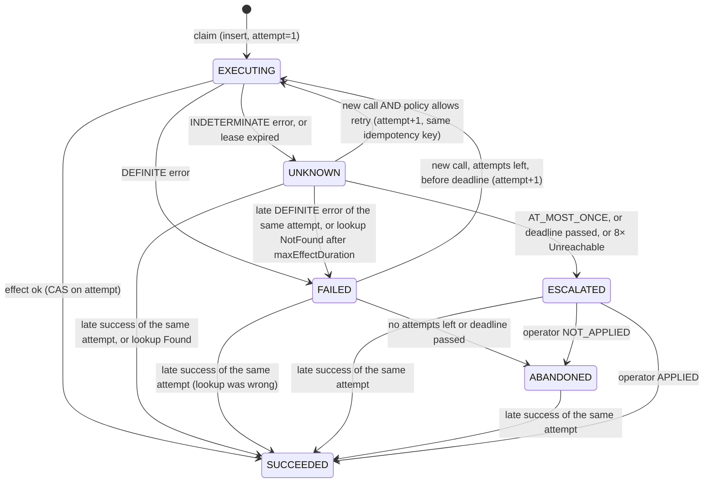

# Design — reliable-agent-actions (working name)

Status: **DESIGN APPROVED** by the author (2026-11-09, revision 6; earlier: fourth independent review: approve with comments — see §14).
No implementation code until the author approves. Properties not yet covered by an executed test are **argued, not
verified**. Numbers marked ASSUMPTION need the author's confirmation. Facts about other projects: `docs/research/*.md`
(desk research of 2026-11-09, re-verify before publishing). Name `reliable-agent-actions`, module prefix `raa-`, Maven
namespace `io.github.oleksii-fenin` (OPEN-QUESTIONS OQ1, OQ5).

## 1. Frame

**Problem.** Agent frameworks run side-effecting tools at-least-once in practice: the model re-emits a call after a
crash, a timeout or a "try again"; the provider tool-call id changes on regeneration; LangChain4j stores the assistant
message with tool calls *before* execution and the results *after* the round, so a crash in between leaves a persistent
memory that providers reject and that does not say whether the effect happened. Durable-execution engines (Temporal,
Restate, DBOS) checkpoint completed steps but re-run a step that crashed mid-flight and deduplicate by step identity,
not by the business meaning of a regenerated call. quarkus-langchain4j documents "tools are expected to be idempotent"
(PR #2749) — the gap is left to every user.

**Users.** Java teams that run an agent inside an existing service (LangChain4j first, Spring AI second) and already
operate PostgreSQL. Operators: the same team. No extra server.

**Functional requirements**

| # | Requirement |
|---|---|
| R1 | For one action key, at most one attempt holds a **live lease**, and only the current attempt can change the journal row (fencing by attempt number). A stale attempt can still reach the downstream; preventing a second *external* effect from it is the job of the downstream idempotency key (`IDEMPOTENT_DOWNSTREAM`) — see non-guarantees. |
| R2 | A succeeded action is never re-executed; a repeated call with the same key and the same material arguments returns the recorded result; with different material arguments it returns an explicit conflict. |
| R3 | An attempt whose outcome is unknown (crash, timeout, indeterminate error, lost lease) is never retried silently; it becomes `UNKNOWN` and is handled only as its policy allows. |
| R4 | Every action has a deadline and every attempt a maximum effect duration; after the deadline no new attempt starts; an unresolved unknown outcome is escalated, never reported as "not done". |
| R5 | Every side-effecting tool has an explicit policy (`IDEMPOTENT_DOWNSTREAM`, `RECONCILABLE`, `AT_MOST_ONCE`, `AT_LEAST_ONCE`) or is declared `NONE`; wiring fails otherwise. |
| R6 | LangChain4j integration by wiring only (`ReliableTools.wrap`); tool bodies unchanged except optionally reading `ActionContext.current().idempotencyKey()`. |
| R7 | Opt-in repair of LangChain4j chat memory: tool calls without results are answered truthfully from the journal. |
| R8 | Each action emits an OpenTelemetry span and metrics; state transitions are observable; unresolved actions are countable. |
| R9 | The guarantees are proven by an automated process-kill and process-pause test per policy, run in CI, with negative controls. |
| R10 | Journal unavailable → side-effecting tools fail closed (effect not started, explicit result to the model) within a bounded time. |

**Non-goals (v0.1).** Multi-step workflow orchestration, compensation/sagas, ordering between actions, automatic
re-execution without a caller, a UI, a server, storages other than PostgreSQL, Spring AI and MCP adapters (v0.2),
async tool execution.

## 2. Quality scenarios

All measures are ASSUMPTIONS proposed by the design; they drive tests, not marketing.

| # | Attribute | Stimulus | Response | Measure |
|---|---|---|---|---|
| Q1 | Correctness | process killed (SIGKILL) at each fault point (§9), resumed in each mode, the agent follows the tool result text (re-calls when told it is safe) | effects applied downstream per key, final state | **exact match** with the expected-outcome table §9.1 (effect count, final state, model-visible text) for all 32 cells; **0** reports "not performed" for an applied effect |
| Q1p | Correctness under pause | process paused (SIGSTOP) past its lease during the effect, another caller retries, process resumed (SIGCONT) | effects, journal writes of the stale attempt | `IDEMPOTENT_DOWNSTREAM` **= 1** (downstream dedup); stale journal writes **0 rows**; `RECONCILABLE`: duplicate **demonstrated and documented**, not hidden |
| Q2 | Correctness | 32 threads in 2 JVMs call the same key at once | live leases / effects started | **1**; others get `Replayed` or `InProgressElsewhere` |
| Q3 | Overhead | one journaled action, PostgreSQL on the same host | added latency | p99 **< 10 ms** (2 short transactions on the happy path) |
| Q4 | Recovery | process dies during the effect | dead attempt detected; `RECONCILABLE` resolved | detected **≤ 45 s** (lease 30 s + sweep 15 s); resolved ≤ 45 s + `maxEffectDuration` + lookup |
| Q5 | Throughput | one PostgreSQL | sustained journaled actions | **≥ 200/s** (4× the estimated peak, 40× the average; not optimized beyond) |
| Q6 | Availability | journal DB down, unreachable (TCP blackhole), or pool exhausted | effect not started, result to the model within | **≤ 3 s** on the claim path (`claimTimeout` 2.5 s: pool wait, connect and network timeouts derived from the remaining budget); a live-lease poll (`inProgressWait` 2 s) or an inline lookup (`lookupTimeout` 5 s) adds its own bound |
| Q7 | Upgradability | new LangChain4j minor release | adapter contract tests | pass on floor (1.14.0) and latest, weekly scheduled CI |

Priority: Q1, Q1p, Q2 (the thesis) > Q6 > Q4 > Q3 > Q7 > Q5.

## 3. Estimates

* Side-effecting tool calls follow LLM round trips of 0.5–30 s. Busy service: 50 concurrent conversations ×
  1 side-effecting call per 10 s = **5 actions/s**; peak ×10 = **50/s** (ASSUMPTION, no user data yet).
* Row size ≈ 0.5–4 KB (hashes, metadata, result text). At 5/s: 5 × 86 400 × 2 KB ≈ **0.86 GB/day**; retention
  7 days ≈ 6 GB → retention job required in v0.1.
* Journal round trips: claim (1 transaction) + record (1 transaction) + renewal (1 batched statement per process per
  15 s) + reconciler sweep (1 short transaction per 15 s per process).
* Connections: one per in-flight claim/record for milliseconds; none held during the effect. Recommended dedicated
  journal pool: `in-flight tool calls / 10 + 2` (ASSUMPTION).
* Input that changes the design if 10× wrong: the action rate. At ≥ 5 000/s per-row updates on one table become the
  bottleneck → partitioning or another store. Not expected for agent workloads.

## 4. Modules (Gradle multi-module)

| Module | Content | Depends on | Release |
|---|---|---|---|
| `raa-storage-api` | the storage contract only: `ActionJournal`, `ActionAdmin`, `ClaimDecider` (interface), the records and enums they exchange (`ClaimRequest`, `ClaimResult`, `ActionRecord`, `ActionState`, `KeyAttempt`, …) | JDK only | v0.1 |
| `raa-core` | API types, policies, state machine, decision table (`ClaimDecider` implementation), `ActionRunner`, `Reconciler`, `LeaseRenewer`, `ActionTelemetry` (no-op) | `raa-storage-api` (Gradle `api`, i.e. transitive) | v0.1 |
| `raa-postgres` | `PostgresActionJournal` implements `ActionJournal` + `ActionAdmin` (plain JDBC, `DataSource`), schema `V1__raa_action.sql` (plain SQL, Flyway/Liquibase-compatible), retention | `raa-storage-api` only (**not** core), PostgreSQL JDBC (runtime) | v0.1 |
| `raa-journal-tck` | conformance test suite for `ActionJournal` implementations (depends on `raa-storage-api`; uses core's real `ClaimDecider` as a test dependency) (JUnit 5, abstract test classes; the storage module supplies a running database) — `raa-postgres` must pass it; third-party storages use it to prove correctness | core, JUnit | v0.1 |
| `raa-langchain4j` | `ReliableToolExecutor`, `ReliableTools`, `JournalChatMemoryRepair`, default `OutcomeRenderer` | core, `langchain4j` ≥ 1.14.0 (compile-only) | v0.1 |
| `raa-opentelemetry` | `OpenTelemetryActionTelemetry`: spans + metrics on the OTel API | core, `opentelemetry-api` | v0.1 |
| `raa-testkit` | fault points, `FakeDownstream` (HTTP, effect counter, dedup and lookup switchable), kill/pause harness, in-memory journal for unit tests | core | v0.1 (published: users can kill-test their own tools) |
| `examples/langchain4j-refund` | runnable example with a scripted fake chat model, Testcontainers PostgreSQL | all v0.1 | not published |
| `raa-bom` | Maven BOM (`java-platform`) pinning the versions of all published `raa-*` modules, so users import one version | — | v0.1 (cheap; added when the first artifacts are published, week 7) |
| `raa-spring-ai` | `ReliableToolCallback` | core, Spring AI 2.0.x | v0.2 |
| `raa-spring-boot-starter` | auto-config (journal from `DataSource`, reconciler/renewer scheduling, properties) | core, postgres, Spring Boot | v0.2 |
| `raa-mcp` | server-side wrapper for MCP Java SDK tool handlers | core | v0.2+ |

**Module principle (author, 2026-11-09).** Small, loosely coupled modules assembled like a construction kit:
dependencies point only towards contracts (`raa-storage-api`, core's public API), never from a contract to an
implementation and never between sibling implementations (storage ↔ adapter ↔ telemetry). Every pluggable concern is
an interface in the contract module plus independent implementation modules chosen at wiring time. The counterweight
(CLAUDE.md): a new module still needs a scenario in this document — modules are split along real replacement points
(storage, framework adapter, telemetry), not per class.

Build: Gradle Kotlin DSL, JDK 25 toolchain, bytecode `--release 17` (OQ3, decided), CI test matrix 17/21/25.
License Apache-2.0 (OQ2, decided).

**Storage contract (OQ4, decided; refined 2026-11-09).** Three published artifacts form the storage layer:

```
raa-storage-api   ← contract (interfaces + data types), JDK only
   ↑ api              ↑ implementation
raa-core          raa-postgres            (core and postgres do not know each other)
```

* `raa-core` exposes `raa-storage-api` transitively, so users write against core and the contract types.
* A storage module depends on `raa-storage-api` only. It never sees the decision table, the reconciler or the
  adapters; it receives the decision logic as a `ClaimDecider` argument (dependency inversion: core owns the policy,
  storage owns atomicity).
* The application picks the implementation at wiring time — `ReliableActions.builder(PostgresActionJournal.create(dataSource))`
  in plain Java, a `@Bean ActionJournal` in Spring (starter in v0.2). Replacing the storage = replacing that one
  dependency and one bean; no change in core, adapters or tool code. No `ServiceLoader` magic: explicit wiring keeps
  "which database is the journal" visible.
* Users depend on `raa-core` plus exactly one storage module. `raa-storage-api` is a public, versioned contract with
  its own compatibility promise: its Javadoc states every required atomicity, CAS and time rule; a breaking change is a
  major version. PostgreSQL is the only supported implementation; others are accepted when they pass
  `raa-journal-tck`.
* Compliance: a build check (ArchUnit or Gradle dependency rule) fails if `raa-storage-api` depends on anything but
  the JDK, or if `raa-postgres` depends on `raa-core`.

## 5. Public API (signature level)

```java
// ---- raa-core: identity
public record ActionKey(String scope, String name, List<String> businessParts) {
    public static ActionKey of(String scope, String name, Object... businessParts); // scope must be non-blank
    public byte[] hash();                // SHA-256 over a length-prefixed canonical encoding (no delimiter ambiguity)
    // idempotency key (ActionContext): "raa-" + base64url(SHA-256(key hash ‖ material-args hash)), 47 chars —
    // stable across retries with the same arguments; changes only when a definitely failed action is retried
    // with corrected arguments (so a downstream never sees one key with two parameter sets)
}
public record ToolCall(String toolName, String argumentsJson, String providerCallId /*nullable*/,
                       String scope /*memory or conversation id; nullable here, but KeyStrategy must yield one*/) {}

@FunctionalInterface public interface KeyStrategy { ActionKey keyFor(ToolCall call, Arguments args); }
public interface Arguments { String string(String name); long longValue(String name); BigDecimal decimal(String name); }

// ---- policies (immutable, one per tool)
public sealed interface ActionPolicy permits IdempotentDownstream, Reconcilable, AtMostOnce, AtLeastOnce, NoJournal {
    static IdempotentDownstream idempotentDownstream(Duration downstreamDedupWindow);
    static Reconcilable reconcilable(OutcomeLookup lookup);
    static AtMostOnce atMostOnce();
    static AtLeastOnce atLeastOnce();
    static NoJournal none();
}
// builder methods on every journaled policy:
//   key(KeyStrategy)                    mandatory
//   maxEffectDuration(Duration)         mandatory; must be ≥ the tool's client timeout; lease is not renewed beyond it
//   deadline(Duration)                  default 15 min; IdempotentDownstream: must be ≤ downstreamDedupWindow
//   maxAttempts(int)                    default 3
//   freeTextArguments(String...)        arguments excluded from the conflict check (e.g. e-mail body); default none.
//                                       Material arguments are canonicalized: JSON keys sorted, numbers as
//                                       BigDecimal.stripTrailingZeros, values coerced to the tool schema's type
//   failureClassifier(FailureClassifier)
//   lookup(OutcomeLookup)               optional, except Reconcilable; lookupTimeout(Duration = 5 s)
// wiring validation: maxEffectDuration < deadline; IdempotentDownstream: deadline <= downstreamDedupWindow

@FunctionalInterface public interface FailureClassifier { FailureKind classify(Throwable error, boolean effectStarted); }
// default: DEFINITE if !effectStarted (see ActionContext.beforeSideEffect) or ActionRejectedException; else INDETERMINATE

@FunctionalInterface public interface OutcomeLookup { LookupResult lookup(ActionKey key, String idempotencyKey); }
public sealed interface LookupResult {
    record Found(String resultText) implements LookupResult {}
    record NotFound() implements LookupResult {}
    record Unreachable(String reason) implements LookupResult {}
}

// ---- registry
public final class ReliableActions {
    public static Builder builder(ActionJournal journal);
    // Builder: tool(String toolName, ActionPolicy), lease(Duration = 30 s), inProgressWait(Duration = 2 s),
    //          claimTimeout(Duration = 2.5 s), recordRetryBudget(Duration = 3 s), telemetry(ActionTelemetry).
    //          No clock setting: DB time only. Process owner id = random UUID per process start.
    public ActionRunner runner();
    public Reconciler reconciler();               // runOnce(); scheduled by the app (or the v0.2 starter)
    public LeaseRenewer leaseRenewer();           // start()/close(); one per process
    public ActionAdmin admin();
}

// ---- execution
@FunctionalInterface public interface Effect { String execute(ActionContext context) throws Exception; }
public final class ActionRunner { public ActionOutcome run(ToolCall call, Effect effect); }
public sealed interface ActionOutcome {
    record Succeeded(String resultText, int attempt) implements ActionOutcome {}
    record Replayed(String resultText, Instant completedAt, boolean fromLookup) implements ActionOutcome {}
    record Conflict(String recordedResultText /*nullable*/, boolean previousUnresolved) implements ActionOutcome {}
    record InProgressElsewhere(Instant leaseUntil) implements ActionOutcome {}
    record Unknown(RepeatAdvice advice, String reason) implements ActionOutcome {}
    // RepeatAdvice: SAFE (IDEMPOTENT_DOWNSTREAM), MAY_DUPLICATE (AT_LEAST_ONCE), ASK_LATER (lookup pending)
    record Failed(String error, boolean retryable) implements ActionOutcome {}  // effect definitely not applied
    record Abandoned(String reason) implements ActionOutcome {}                 // not applied; no attempts left
    record Escalated(String reason) implements ActionOutcome {}                 // unknown; operator needed
    record JournalUnavailable(String reason) implements ActionOutcome {}        // not applied (fail closed)
}
public final class ActionContext {
    public static ActionContext current();     // ThreadLocal set around the effect; throws IllegalStateException
                                               // outside it (e.g. tool code hopped threads) — never returns null
    public String idempotencyKey(); public int attempt(); public ActionKey key();
    public void beforeSideEffect();            // optional marker: exceptions before it are DEFINITE by default
}
public final class ActionRejectedException extends RuntimeException {}   // tool says: definitely not applied

// ---- operator API
public interface ActionAdmin {
    List<ActionRecord> find(ActionState state, int limit);
    boolean resolveManually(byte[] keyHash, int attempt, ManualResolution resolution); // APPLIED(text) | NOT_APPLIED
    int redact(byte[] keyHash);                // erase result/error/arguments (personal-data requests); keeps the dedup row
}

// ---- SPI, module raa-storage-api (implemented by raa-postgres). All writes are compare-and-set on (key_hash, attempt) and run at READ COMMITTED.
public interface ActionJournal {
    ClaimResult claim(ClaimRequest request, ClaimDecider decider);  // FOR UPDATE + decider + apply, one transaction
    RecordResult recordSuccess(byte[] keyHash, int attempt, String resultText);
    //   APPLIED | SUPERSEDED (a newer attempt exists) | ALREADY_SUCCEEDED(row) (e.g. resolved earlier by lookup)
    RecordResult recordFailure(byte[] keyHash, int attempt, FailureKind kind, String error);
    boolean markUnknownIfLeaseExpired(byte[] keyHash, int attempt, String reason);
    //   WHERE attempt = ? AND state = 'EXECUTING' AND lease_until < clock_timestamp(); sets resolve_after = clock_timestamp()
    int renewLeases(String owner, Collection<KeyAttempt> inFlight, Duration lease);      // per (key, attempt)
    List<ActionRecord> takeReconcileBatch(String reconcilerOwner, Duration hold, int limit); // short tx, SKIP LOCKED
    boolean resolve(byte[] keyHash, int attempt, Resolution resolution);  // WHERE attempt = ? AND state = 'UNKNOWN'
    Optional<CallRecord> findByProviderCallId(String providerCallId);                    // via call history table
    int deleteTerminalOlderThan(Duration retention, int batchSize);
}

// ---- raa-langchain4j
public final class ReliableToolExecutor implements dev.langchain4j.service.tool.ToolExecutor {
    // overrides execute(...) and executeWithContext(...); executeAsync(...) throws UnsupportedOperationException (v0.1)
}
public final class ReliableTools {
    public static List<AiServiceTool> wrap(Object toolBean, ReliableActions actions);   // via ToolService.findTools;
    // rejects tools with ReturnBehavior.IMMEDIATE unless allowImmediateReturn(toolName) is set (see §8)
}
public final class JournalChatMemoryRepair { public RepairReport repair(ChatMemory memory); }
public interface OutcomeRenderer { String render(ActionOutcome outcome, ToolCall call); }   // text for the model
```

## 6. Action lifecycle

States: `EXECUTING`, `SUCCEEDED`, `FAILED`, `UNKNOWN`, `ABANDONED`, `ESCALATED`.
Terminal: `SUCCEEDED`, `ABANDONED`; `ESCALATED` is terminal for automation (an operator resolves it).



**Time.** All decisions use `clock_timestamp()` (not `now()`, which is the transaction start and can be stale after a
lock wait). The JVM clock is never used.

**Decision table — a call arrives for key K.** The table is a pure function in `raa-core` (`ClaimDecider`); the
SPI `claim` loads the row with `SELECT … FOR UPDATE`, calls the decider and applies its decision **in the same short
transaction**, so the logic exists once and the TCK checks only atomicity. Lookups never run inside that transaction:
the decider returns `NEEDS_LOOKUP`, core performs the lookup, applies a CAS `resolve`, and claims again.
Rows are evaluated **top to bottom, first match wins**. "Args differ" = material-argument hash differs;
"all args differ" = hash over all arguments incl. free text differs. `FAILED` carries `failure_basis`:
`DEFINITE` (the tool reported a definite error) or `LOOKUP` (a lookup said `NotFound` — not proof).

| # | Row for K | Condition | Action | Outcome to caller |
|---|---|---|---|---|
| 1 | none | — | insert `EXECUTING`, attempt 1, lease, `deadline_at`; commit; run effect | Succeeded / Failed / Unknown |
| 2 | `SUCCEEDED` | args differ | none | `Conflict(recorded result)` |
| 3 | `SUCCEEDED` | — | none | `Replayed` |
| 4 | `EXECUTING` | args differ | none | `Conflict(previousUnresolved)` |
| 5 | `EXECUTING` | lease live | poll up to `inProgressWait` (2 s) | its outcome if it completes, else `InProgressElsewhere` |
| 6 | `EXECUTING` | lease expired | `markUnknownIfLeaseExpired`, re-evaluate as `UNKNOWN` | — |
| 7 | `UNKNOWN` | args differ, or (`IDEMPOTENT_DOWNSTREAM` and all args differ) | none — a retry could duplicate, or reuse a downstream key with a different body | `Conflict(previousUnresolved)` |
| 8 | `UNKNOWN` | a lookup is declared, `clock_timestamp() > started_at + maxEffectDuration` | `NEEDS_LOOKUP` (bounded by `lookupTimeout`, default 5 s; timeout = Unreachable) → Found: `SUCCEEDED`; NotFound: `AT_MOST_ONCE` → `ESCALATED`, others → `FAILED(LOOKUP)` and re-evaluate; Unreachable: `IDEMPOTENT_DOWNSTREAM`/`AT_LEAST_ONCE` continue at row 10 (rows 8–9 skipped), `RECONCILABLE`/`AT_MOST_ONCE` before the deadline return `Unknown(ASK_LATER)` with backoff, at/after the deadline continue at row 10 | `Replayed(fromLookup)` / … / `Unknown(ASK_LATER)` |
| 9 | `UNKNOWN` | a lookup is declared, before `started_at + maxEffectDuration` | none | `Unknown(ASK_LATER)` |
| 10 | `UNKNOWN` | deadline passed or attempts exhausted (after the lookup of row 8, if any) | → `ESCALATED` | `Escalated` |
| 11 | `UNKNOWN` | `AT_MOST_ONCE` | → `ESCALATED` | `Escalated` |
| 12 | `UNKNOWN` | `IDEMPOTENT_DOWNSTREAM` / `AT_LEAST_ONCE` | attempt+1, same idempotency key; store the call's material and all-args hashes | Succeeded / Failed / Unknown |
| 13 | `FAILED` | deadline passed or attempts exhausted | → `ABANDONED` | `Abandoned` |
| 14 | `FAILED(LOOKUP)` | args differ | none (the earlier attempt may still land under the old key) | `Conflict(previousUnresolved)` |
| 15 | `FAILED` | — (`DEFINITE`: args may differ; `LOOKUP`: same args) | attempt+1; store the call's material and all-args hashes (material change → new idempotency key) | Succeeded / Failed / Unknown |
| 16 | `ABANDONED` / `ESCALATED` | — (also with different args: the earlier outcome is reported, not a `Conflict`) | none | same outcome |

Note on row 8 order: rows 8–9 sit before 11–12 deliberately — a declared lookup is consulted before a retry, but an
unreachable lookup never blocks a retry that the policy already makes safe.

**Inspect mode.** `JournalChatMemoryRepair` evaluates the same table with effects disabled: transitions that need no
effect (lease expiry → `UNKNOWN`, lookup resolution, escalation) are applied; rows that would start an attempt
(1, 12, 15) return `Unknown(SAFE)` / `Unknown(MAY_DUPLICATE)` / "not performed; you may call again with the same
arguments" instead. Repair and a real call therefore never disagree.

**Inline result handling.** Return value → `recordSuccess(key, attempt)`; exception → `FailureClassifier`
(`DEFINITE` → `FAILED`; `INDETERMINATE`, the default once the effect may have started → `UNKNOWN`).
`recordSuccess` is a CAS `WHERE key_hash = ? AND attempt = ? AND state <> 'SUCCEEDED'` — a late success of the
**same** attempt lands in any state (`EXECUTING`, `UNKNOWN`, `FAILED`, `ESCALATED`, `ABANDONED`); landing on `FAILED`
or `ABANDONED` means a lookup was wrong and is counted as `raa.late_result_corrected` with a WARN log.
`recordFailure` is a CAS `WHERE attempt = ? AND state IN ('EXECUTING','UNKNOWN')`. `SUPERSEDED` (a newer attempt
exists) → the caller gets its own real result, counted as `stale_success`. `ALREADY_SUCCEEDED` → the caller gets its
real result; the journal keeps the first recorded text. If the record budget is exhausted the caller still gets the
real result (`Succeeded`) and the row resolves through `UNKNOWN`. Record writes are retried within
`recordRetryBudget` (3 s); an ambiguous failure is followed by a read-back by `(key_hash, attempt)` before classifying.
The thread's interrupt flag is cleared around the record write and restored afterwards.

**What the model is told** (default `OutcomeRenderer`, replaceable): `Succeeded`/`Replayed` → the result text
(verbatim; `fromLookup` results use the lookup text); `Conflict` → "this action was already performed:
<recorded result>; it was not performed again" (or, when the previous outcome is unresolved, "a previous attempt with
different arguments has an unknown outcome; not performed"); `Unknown(SAFE)` → "outcome unknown; it is safe to call
this tool again with the same arguments"; `Unknown(MAY_DUPLICATE)` → "outcome unknown; calling again may perform it
twice — repeat only if a duplicate is acceptable"; `Unknown(ASK_LATER)` → "being verified; do not repeat now; call
again after <time> to get the outcome"; `InProgressElsewhere` → "already in progress; do not repeat";
`Escalated` → "could not be verified automatically; an operator has been notified; do not repeat";
`Abandoned`/`Failed`/`JournalUnavailable` → "not performed: <reason>".

**Reconciler** (`runOnce`, every 15 s, safe on many processes):
1. `takeReconcileBatch`: one short transaction — `SELECT … FOR UPDATE SKIP LOCKED LIMIT n` of rows that are
   `EXECUTING` with expired lease, `UNKNOWN`/`FAILED` with `coalesce(resolve_after, '-infinity') <= clock_timestamp()`
   (every transition into `UNKNOWN`/`FAILED` also sets `resolve_after = clock_timestamp()`), or past deadline; sets
   `resolve_after = clock_timestamp() + hold` (a reconciler lease); commits. No lock is held during lookups.
2. Per row, outside any transaction: expired `EXECUTING` → `markUnknownIfLeaseExpired`; `UNKNOWN` with lookup and
   `maxEffectDuration` passed → lookup → CAS `resolve` (`SUCCEEDED` / `FAILED` / backoff
   `resolve_after = clock_timestamp() + min(2^n × 15 s, 10 min)`; `ESCALATED` after 8 `Unreachable`).
3. Past deadline: `UNKNOWN` → one lookup if declared (Found → `SUCCEEDED`, NotFound → `FAILED(LOOKUP)` →
   `ABANDONED`), otherwise or on `Unreachable` → `ESCALATED`; `FAILED` → `ABANDONED`.
4. Never executes an effect (ADR-0001). Consequence: an `IDEMPOTENT_DOWNSTREAM` action left `UNKNOWN` without a later
   call is `ESCALATED` at its deadline.

**Lease renewer.** Every `lease/2`: `UPDATE raa_action SET lease_until = clock_timestamp() + :lease
WHERE (key_hash, attempt) IN (:inFlight) AND state = 'EXECUTING' AND lease_owner = :owner
AND clock_timestamp() < started_at + max_effect_duration`. In-flight entries are registered at claim and removed in
`finally`. Rows outside the predicate (moved to `UNKNOWN`, newer attempt, overrun) are not renewed; overrun effects
therefore lose their lease and become `UNKNOWN` (R4) even though the thread cannot be killed.

## 7. Storage (PostgreSQL ≥ 14, decided 2026-11-09; CI tests 14 and the latest release)

```sql
create table raa_action (
    key_hash            bytea        primary key,     -- SHA-256 of the canonical ActionKey (raw key not stored by default)
    key_text            text,                         -- opt-in, for operators; may contain personal data
    tool_name           varchar(200) not null,
    policy              varchar(32)  not null,
    state               varchar(16)  not null check (state in ('EXECUTING','SUCCEEDED','FAILED','UNKNOWN','ABANDONED','ESCALATED')),
    attempt             integer      not null,        -- fencing token
    lease_owner         varchar(64),
    lease_until         timestamptz,
    max_effect_duration interval     not null,
    created_at          timestamptz  not null default clock_timestamp(),
    deadline_at         timestamptz  not null,
    started_at          timestamptz  not null,        -- start of the current attempt
    updated_at          timestamptz  not null default clock_timestamp(),
    resolve_after       timestamptz,
    lookup_failures     integer      not null default 0,
    failure_basis       varchar(8)   check (failure_basis in ('DEFINITE','LOOKUP')),  -- set when state = 'FAILED'
    all_args_hash       bytea        not null,        -- incl. free-text arguments (row 7)
    scope_hash          bytea        not null,
    material_args_hash  bytea        not null,
    arguments_json      jsonb,                        -- opt-in only (personal data)
    result_text         text,                         -- needed for replay; personal data → retention, redact()
    last_error          text
);
create table raa_action_call (                        -- every provider call id ever mapped to an action
    scope_hash          bytea        not null,
    provider_call_id    varchar(200) not null,        -- calls without an id are not recorded (see §8)
    key_hash            bytea        not null references raa_action (key_hash) on delete cascade,
    attempt             integer      not null,        -- latest attempt started by this call (upsert)
    seen_at             timestamptz  not null default clock_timestamp(),
    primary key (scope_hash, provider_call_id)
);
create index raa_action_expired_lease on raa_action (lease_until)   where state = 'EXECUTING';
create index raa_action_resolve       on raa_action (resolve_after nulls first) where state in ('UNKNOWN','FAILED');
create index raa_action_terminal      on raa_action (updated_at)    where state in ('SUCCEEDED','ABANDONED');
```

Claim transaction (READ COMMITTED; `Connection.setNetworkTimeout` and statement timeout from the remaining
`claimTimeout`): `INSERT … ON CONFLICT (key_hash) DO NOTHING RETURNING …`;
if no row returned, `SELECT … FOR UPDATE`; if that also returns nothing (deleted by retention in between), repeat at
most 3 times. Then the decision table; call-id row inserted (`ON CONFLICT DO NOTHING`) in the same transaction.
Retention deletes `SUCCEEDED`/`ABANDONED` older than 7 days (default) in batches of 1 000; `ESCALATED`, `UNKNOWN`,
`EXECUTING` are never deleted automatically.

**Durability requirement.** The journal relies on committed rows surviving failover. With asynchronous replication a
failover can lose a committed claim and the same key executes again — for every policy. Documented requirement:
synchronous replication (`synchronous_commit = on` with a synchronous standby) or a single primary with durable storage;
otherwise the guarantee is reduced to "per failover epoch".

## 8. Failure table

| Where it fails | What the system sees | How it recovers |
|---|---|---|
| Crash before the claim commits | no row | next call claims normally; repair answers "not executed; you may call again" |
| Claim commit ambiguous (connection lost after COMMIT) | caller got an error; row may exist | caller returns `JournalUnavailable` **without** running the effect; if the row exists it becomes `UNKNOWN` after the lease. Effect never ran, yet `AT_MOST_ONCE` escalates it (accepted: false escalation, never a false "not done") |
| Crash after the claim, before the effect | `EXECUTING`, lease expires | → `UNKNOWN` (cannot tell "not started" from "in flight"); per policy |
| Crash during or after the effect, before the record | `EXECUTING`, lease expires | → `UNKNOWN` → retry with the same key / lookup / escalate |
| Crash after the record, before chat memory | `SUCCEEDED`; memory has a dangling call | repair inserts the recorded result; a regenerated call with a new id gets `Replayed` |
| Record write fails or is ambiguous | effect applied, row `EXECUTING` | retries within 3 s, read-back by `(key, attempt)`; then `UNKNOWN` after the lease → policy |
| Thread interrupted after the effect returned | interrupt flag set | flag cleared for the record write, restored after |
| Downstream timeout / 5xx / IO error | INDETERMINATE | `UNKNOWN`; model told per policy (safe to repeat / being verified) |
| Exception before `beforeSideEffect()`, 4xx validation, `ActionRejectedException` | DEFINITE | `FAILED`; the model gets the error and may correct arguments |
| Model changes material arguments after success, same key | hash mismatch | `Conflict` with the recorded result; no effect |
| Model changes free-text arguments only (e.g. e-mail body) | hash equal | `Replayed` — by design (`freeTextArguments`) |
| Same key twice in one turn (concurrent tool execution) | live lease | second call polls ≤ 2 s; gets the outcome or `InProgressElsewhere`; the first call's result is in the same turn |
| Model retries a `FAILED` action with corrected arguments | args differ, state `FAILED` | `failure_basis = DEFINITE`: new attempt with a new idempotency key (the first one definitely did not apply); `LOOKUP`: `Conflict(previousUnresolved)` (row 14) |
| Model retries an `UNKNOWN` action with different arguments | args differ, state `UNKNOWN` | `Conflict(previousUnresolved)`; no effect |
| Lookup said `NotFound`, then the paused attempt succeeds | row `FAILED`/`ABANDONED`, same attempt | late success lands → `SUCCEEDED`, `late_result_corrected` metric; a "not performed" text may already have been shown — part of the `RECONCILABLE` non-guarantee |
| Provider sends no tool-call id (some Gemini/Ollama responses) | no call-id row | dedup by business key still works; memory repair cannot map the call and reports it as `UNMAPPED` (no text inserted) |
| Two processes, same key | unique key + lease | one executes; the other `Replayed` or `InProgressElsewhere` after ≤ 2 s |
| Process paused > lease (GC, VM freeze, SIGSTOP), then resumes | row `UNKNOWN`, maybe attempt n+1 | stale journal writes fenced (0 rows); `IDEMPOTENT_DOWNSTREAM`: downstream dedups; `AT_LEAST_ONCE`: duplicate allowed; `RECONCILABLE`: duplicate possible if the paused request lands after a `NotFound` — non-guarantee, demonstrated by Q1p |
| Renewer starved (pool exhausted, DB slow) | leases expire while effects run | same as pause; dedicated small journal pool, renewer uses its own connection budget |
| Effect hangs beyond `maxEffectDuration` | renewal stops | lease expires → `UNKNOWN`; a late result of the same attempt still lands via CAS |
| Pool exhausted at claim | no connection within `claimTimeout` (2.5 s) | `JournalUnavailable`, effect not started (Q6) |
| Journal DB down | claim fails | fail closed: `JournalUnavailable` |
| Async replica failover lost committed rows | row missing | **not handled** — see §7 durability requirement |
| Tool code hops threads | `ActionContext.current()` called outside the context | `IllegalStateException` (loud), never a null key |
| Tool registered with `ReturnBehavior.IMMEDIATE` | library texts ("in progress", "being verified") would become the final user-facing answer | `wrap` rejects such tools unless explicitly allowed |
| Async tool execution (`executeAsync`) | unsupported in v0.1 | `UnsupportedOperationException` with a clear message |
| Tools registered via `ToolProvider`/MCP and not wrapped | not journaled | documented; optional strict mode fails if a tool without a policy is observed at runtime (v0.2) |
| Memory repair while an attempt for that call is live | live lease | repair skips that call and reports `PENDING`; never writes "being verified" for a live attempt |
| Memory repair for a call id that was superseded by a regenerated call | call-id history maps both ids to the action | truthful answer from the action row |
| Deadline passed | non-terminal row | no new attempts; `UNKNOWN` → lookup or `ESCALATED`; `FAILED` → `ABANDONED` |
| Lookup unreachable | `Unreachable` | backoff, `ESCALATED` after 8 tries or at the deadline; metric + log |
| Downstream dedup window shorter than deadline | — | rejected at wiring |
| Retention deleted the row, conversation resumed later | no row | executes again — retention must exceed the resume horizon (documented, configurable) |
| JVM clock skew | — | not used; only `clock_timestamp()` of PostgreSQL |

## 9. Test plan

| Level | What | Proves |
|---|---|---|
| Unit (core) | decision table: every §6 row × policy (table-driven); key canonicalization (no delimiter collisions); policy validation; renderer texts | R2–R5 logic |
| SQL interleavings (Testcontainers PostgreSQL, two connections driven step by step) | claim race insert vs `FOR UPDATE`; renewal after `UNKNOWN`, after attempt+1, for another owner, after overrun → 0 rows; `markUnknownIfLeaseExpired` vs concurrent renewal; late `recordSuccess` after `UNKNOWN` (same attempt → applied; newer attempt → fenced); retention delete during claim; READ COMMITTED asserted | R1, R3, R4 |
| Concurrency (Q2) | 32 threads × 2 JVMs, one key, `FakeDownstream` dedup **off** (counts raw requests) | R1 |
| **Kill matrix (Q1, R9)** | parent JVM hosts PostgreSQL and `FakeDownstream`; the child is started as `java …` directly (no shell/Gradle wrapper; the test asserts the PID is the JVM). Fault points: `AFTER_CLAIM`; `EFFECT_APPLIED_RESPONSE_HELD` — the fake applies the effect, **notifies the parent**, holds the HTTP response; `AFTER_RESPONSE_BEFORE_RECORD`; `AFTER_RECORD_BEFORE_MEMORY`. Parent SIGKILLs the child when the fault point is confirmed, starts a new child that resumes in mode (a) re-call with a new tool-call id, or (b) memory repair, after which the scripted model follows the result text (re-calls if told it is safe). Reconciler runs. Assertions: effect count per key, final state, model-visible text — against an **expected-outcome table** per (policy × point × mode) | R2, R3, R7, R9 |
| Negative controls | same matrix with the library bypassed and with `FakeDownstream` dedup off: the test **must fail** (expects ≥ 2 effects or a false "not executed") — proves the harness can see duplicates | test validity |
| Pause test (Q1p) | `kill -STOP` the child during the held effect past the lease; second child retries; `kill -CONT`; assert stale writes fenced and effect counts per policy; `RECONCILABLE` duplicate asserted as the documented non-guarantee | R1 limits |
| Randomized (nightly) | kill at a random delay inside the effect window; 500 runs per policy | windows the fixed points miss |
| Ambiguous commit / DB faults | Toxiproxy between client and PostgreSQL: cut after COMMIT for claim and record; pause container (fail closed, Q6); pool exhaustion | R10, §8 rows |
| LangChain4j contract | scripted fake `ChatModel`; specs and `ReturnBehavior` preserved; `IMMEDIATE` rejected; concurrent tool execution with same-key calls; replay text; memory repair yields a history where every tool call has a result, including the superseded-call-id case | R6, R7 |
| OTel | `InMemorySpanExporter` / `InMemoryMetricReader`: one span per action with key hash, policy, attempt, outcome | R8 |
| Clock | child JVM under libfaketime shifted ±1 h; decisions unchanged | DB-time rule |
| Wiring | tool without policy, `IMMEDIATE` tool, `maxEffectDuration ≥ deadline`, deadline > dedup window → rejected at build time | R5 |
| Overhead (Q3) | timed loop of 10 000 actions against local PostgreSQL; p50/p99 in README, not a gate | Q3 |

### 9.1 Expected outcomes of the kill matrix

**Deterministic settings.** Lease 2 s, `maxEffectDuration` 3 s, `maxAttempts` 3, deadline 60 s. The background
reconciler is **off** during the resume phase (it runs only in the separate reconciler tests and the randomized
nightly job), so the outcome depends only on the decision table. The resumed child waits until
`started_at + maxEffectDuration + 0.5 s` before acting (lease expired and lookup window open).

**FakeDownstream.** Records every applied effect. `IDEMPOTENT_DOWNSTREAM` column: dedup **on** — the fake stores the
response at apply time under the idempotency key and returns the stored response to any later request with that key
(Stripe-like), even while the original response is still held. `RECONCILABLE` column: lookup by idempotency key **on**,
dedup off. Other columns: dedup and lookup off.

**Scripted model rules (both modes).** Re-call with the same arguments and a new tool-call id when the text is
`SAFE`, `MAY_DUPLICATE` or "not performed; you may call again"; on `ASK_LATER`, re-call after the stated time
(`started_at + maxEffectDuration`); stop on a result, `Replayed`, `Conflict`, `Escalated`, `Abandoned`. At most 3
re-calls. Mode (a): the resumed agent issues the call again. Mode (b): `JournalChatMemoryRepair` (inspect mode) answers
the dangling call, then the model follows the rules.

Cells: effects applied / final state / text the model ends with. (a) and (b) are equal unless noted.

| Fault point | `IDEMPOTENT_DOWNSTREAM` | `RECONCILABLE` | `AT_MOST_ONCE` | `AT_LEAST_ONCE` |
|---|---|---|---|---|
| `AFTER_CLAIM` | 1 / SUCCEEDED / result. (a) row 6→12; (b) repair `SAFE` → re-call → row 12 | 1 / SUCCEEDED / result. Row 8 NotFound → `FAILED(LOOKUP)` → row 15 same args; (b) repair says "not performed; you may call again" → re-call | 0 / ESCALATED / "could not be verified" (false escalation, accepted). (a) row 11; (b) repair applies row 11 | 1 / SUCCEEDED / result. (b) via `MAY_DUPLICATE` → re-call |
| `EFFECT_APPLIED_RESPONSE_HELD` | 1 / SUCCEEDED / stored downstream response (retry deduplicated) | 1 / SUCCEEDED / lookup text (`Replayed(fromLookup)`) | 1 / ESCALATED / "could not be verified" | **2** / SUCCEEDED / result (duplicate by definition) |
| `AFTER_RESPONSE_BEFORE_RECORD` | 1 / SUCCEEDED / stored downstream response | 1 / SUCCEEDED / lookup text | 1 / ESCALATED / "could not be verified" | **2** / SUCCEEDED / result |
| `AFTER_RECORD_BEFORE_MEMORY` | 1 / SUCCEEDED / recorded result: (a) `Replayed`, (b) repaired, no re-call | same | same | same |

Assertions per cell: effect count, final state, final text, and **no** "not performed" text where an effect was
applied. **Negative controls** (must fail, proving the harness sees duplicates): library bypassed —
`IDEMPOTENT_DOWNSTREAM` with dedup off → 2 effects at `EFFECT_APPLIED_RESPONSE_HELD` and `AFTER_RESPONSE_BEFORE_RECORD`;
`AT_MOST_ONCE` → 2 effects at the same two points (not at `AFTER_CLAIM`, where nothing was applied).

**Further deterministic cases** (SQL/pause level): `AT_MOST_ONCE` + lookup (Found → `SUCCEEDED`, NotFound →
`ESCALATED`, never a retry); row 8 with attempts exhausted → row 10; a free-text-only difference across attempts
(row 7 compares the stored all-args hash of the latest attempt); lookup `NotFound` → corrected-args retry is **refused**
(row 14) while the paused attempt n later lands; late success on `ABANDONED` after attempt n+1 started → `SUPERSEDED`;
`EXECUTING` with different args → `Conflict` (row 4); lookup `Unreachable` past the deadline → `ESCALATED`;
`IDEMPOTENT_DOWNSTREAM` + unreachable lookup → retry proceeds (row 8 → row 12).

CI: every PR — unit, SQL interleavings, deterministic kill matrix (4 policies × 4 points × 2 modes = 32 runs) plus
negative controls; nightly — randomized 500 per policy, pause test, Toxiproxy faults, Java 17/21/25, LangChain4j
floor and latest.

## 10. Observability

* Span `reliable_action {tool}` (INTERNAL, child of the current span). Attributes: `gen_ai.tool.name`,
  `gen_ai.tool.call.id` (if known), `raa.policy`, `raa.attempt`, `raa.outcome`, `raa.key.hash` (never the raw key).
  Events for state transitions.
* LangChain4j 1.23.0 emits no tool span, so the adapter can also emit `execute_tool {tool}` per the GenAI semantic
  conventions (status *Development*; flag, default on). Spring AI has its own `spring.ai.tool` observation.
* Metrics: `raa.actions` (counter: policy, outcome), `raa.actions.unresolved` (gauge: `UNKNOWN` + `ESCALATED`),
  `raa.journal.duration` (histogram: operation), `raa.reconciler.resolutions` (counter: result),
  `raa.stale_success`, `raa.late_result_corrected`, `raa.lease.expired` (counters).
* Hashes of low-entropy values (an order id) are reversible by enumeration; `redact()` removes result/arguments/key
  text, keyed hashing (HMAC with an installation secret) is a v0.2 candidate.

## 11. Roadmap to v0.1 (8–12 h/week ≈ 10 h; v0.1 ≈ 75 h)

| Week | Deliverable | Done when (executed evidence) |
|---|---|---|
| 1 | Gradle multi-module skeleton, toolchain, CI build; `raa-core` types, policies, key canonicalization, decision table | `./gradlew build` green; every §6 row covered by a unit test |
| 2 | `raa-journal-tck` (interleaving suite written against the SPI) + `raa-postgres`: schema, claim, CAS writes, renewer, call history | `raa-postgres` passes the TCK; Q2 green |
| 3 | `Reconciler`, `raa-testkit` (fault points, `FakeDownstream`), kill matrix + negative controls on a plain (non-LLM) caller, mode (a) | matrix green, negative controls fail as expected — **stage 1 gate: core + Postgres + kill test** |
| 4 | `raa-langchain4j`: `ReliableToolExecutor`, `ReliableTools.wrap`, `OutcomeRenderer` | contract tests green on LangChain4j 1.14.0 and latest |
| 5 | `JournalChatMemoryRepair`, `examples/langchain4j-refund`, kill matrix through LangChain4j in both modes | Q1 matrix green end-to-end |
| 6 | pause test, Toxiproxy faults, `raa-opentelemetry`; GitHub Actions PR + nightly pipelines | all green locally / on CI |
| 7 | retention, `redact`, overhead measurement, Javadoc, README final; `0.1.0` artifacts built and signed locally | all §9 rows green; publication waits for the author's "ок" |

Buffer: weeks 8–9 (estimate error ±40 %, ASSUMPTION). v0.2 (≈ +4 weeks): Spring AI adapter, Spring Boot starter, MCP
server wrapper, strict mode, optional local-transaction mode (journal row and a local DB effect in one transaction),
`langchain4j-community` proposal.

## 12. Risks

| Risk | Impact | Mitigation |
|---|---|---|
| Niche is narrow; ledger idea exists as small Python/TS/Go projects (e.g. `frogscooper/once`) | weak adoption, "not novel" | lead with what is missing on the JVM: unknown-outcome reconciliation, fencing, memory repair, kill/pause-test evidence; position as complementary to Temporal/DBOS |
| DBOS Java (PostgreSQL, Spring) ships an agent-tool integration | "no engine, just Postgres" pitch weakens | stay usable inside a DBOS step / Temporal activity; per-tool policy and reconciliation remain distinct |
| LangChain4j absorbs the feature | library redundant | contribute the adapter upstream — still attributable original work |
| Wrong keys or free-text declarations by users | false replays or duplicates | mandatory explicit strategy and scope, conflict check on material arguments, docs with patterns |
| Personal data in results/keys | compliance issue for adopters | keys and arguments hashed by default, retention, `redact`, hashed span attributes |
| Async-replica deployments | silent duplicates after failover | documented durability requirement; startup warning if `synchronous_commit` is off (check feasibility in week 2) |
| Framework API churn | adapter breaks | public APIs only, floor+latest CI matrix, weekly scheduled build |
| Schedule (8–12 h/week) | v0.1 slips | stage gates; week 3 alone is a demonstrable result |

## 13. Verified vs argued (as of 2026-11-09)

* Verified: nothing about this library — no code exists.
* Desk research (not re-verified by the author): framework signatures and memory ordering
  (`docs/research/framework-integration-surface.md`), competitor behavior (`docs/research/*.md`).
* Argued: every guarantee in §1/§2 until the §9 tests exist and pass.

## 14. Review log

Revision 2 addresses an independent read-only review (2026-11-09; verdict on revision 1: "reject for now"):
R1 restated as "one live lease + fenced journal" (the lease does not stop a stale effect); late results of the same
attempt land after `UNKNOWN` (CAS on attempt); renewal and `markUnknown` SQL specified with attempt/state/owner/expiry
predicates; `maxEffectDuration` mandatory for all policies and caps renewal; Q1 redefined against an expected-outcome
matrix with negative controls, a held-response fault point and a pause test; call-id history table for truthful repair;
material-argument conflict check; ambiguous commits, failover, pool exhaustion, interrupts, thread hops, `IMMEDIATE`,
same-turn duplicates added to §8; reconciler no longer holds row locks during lookups; `clock_timestamp()` instead of
`now()`; keys stored as hashes; LangChain4j floor corrected to 1.14.0.

Revision 3 addresses the re-review of revision 2 (verdict: "reject for now; N1–N3 + Q1 table then approvable"):
late success of the same attempt lands in any non-`SUCCEEDED` state (N1); `resolve` and `markUnknown` predicates
spelled out; conflict check only on `SUCCEEDED`/`UNKNOWN`, corrected arguments allowed after `FAILED`, idempotency key
derived from key + material arguments, canonical form defined (N2); `resolve_after` set on every transition and
NULL-safe selection (N3); explicit expected-outcome table §9.1; distinct `MAY_DUPLICATE` text for `AT_LEAST_ONCE`;
call-id history keyed by `(scope, call id)`; in-process join removed (same 2 s poll everywhere); decision-table
precedence stated; Q6 budget via network timeouts.

Revision 4 addresses the third review (verdict on revision 3: "reject for now; B1–B3 small edits"): §9.1 made
deterministic (reconciler off during resume, wait past `maxEffectDuration`, scripted-model rules, final text column,
Stripe-like fake, corrected negative controls) and repair defined as inspect mode of the same decision table (B1);
`FAILED` split by `failure_basis`, corrected-args retries only after a `DEFINITE` failure (B2); lookup past the
deadline escalates on `Unreachable` both inline and in the reconciler (B3); `EXECUTING` + different args → `Conflict`;
`IDEMPOTENT_DOWNSTREAM` `UNKNOWN` retry requires identical full arguments; unreachable lookup no longer blocks a safe
retry; decision table owned by core (`ClaimDecider`), applied atomically by the SPI.

Revision 5 applies the fourth review (verdict on revision 4: **approve with comments**, no blocking findings):
`AT_MOST_ONCE` + lookup `NotFound` escalates instead of retrying; every new attempt stores both argument hashes;
row 8 fall-through defined with row 10 checked first; `lookupTimeout`; wiring validation `maxEffectDuration < deadline`;
README and §8 wording aligned with `failure_basis`; ADR-0002 repair texts aligned with inspect mode; clock and wiring
tests listed in §9; module prefix `raa-` (OQ1). Revision 5 changes were self-checked only.

Revision 6 (author decisions, 2026-11-09, self-checked): storage contract moved out of core into the published
`raa-storage-api` (core depends on it transitively, `raa-postgres` depends on it only — core and storage do not know
each other); PostgreSQL floor 14; namespace `io.github.oleksii-fenin`; `raa-bom`; module principle (loosely coupled, dependencies point to contracts) in §4.
