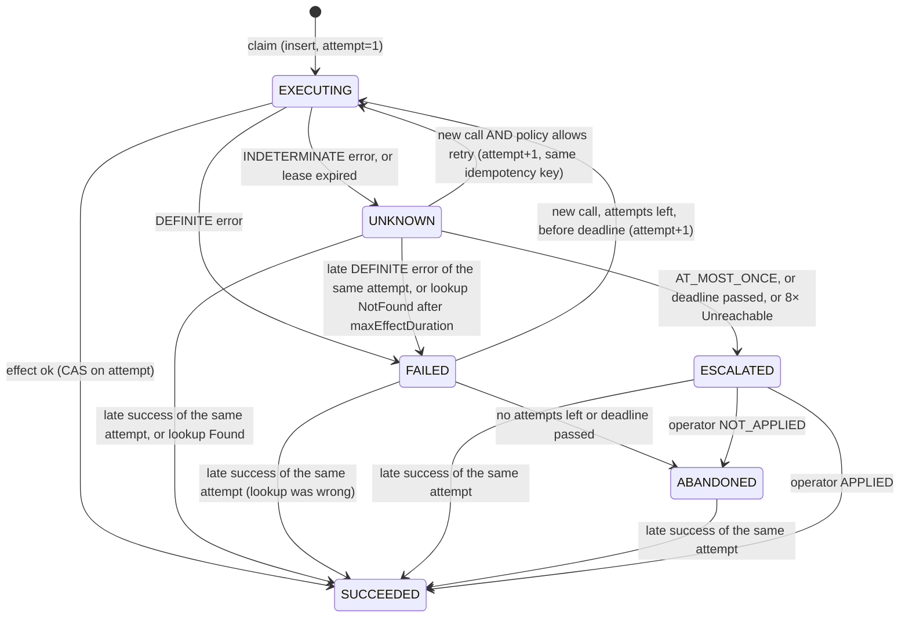

# Design — reliable-agent-actions (working name)

Status: **DESIGN APPROVED** by the author (2026-11-09, revision 6; earlier: fourth independent review: approve with comments — see §14). Revision 7 (2026-11-11): storage-contract refinements found while implementing week 2, see §14. Revision 8 (2026-11-12): runtime of week 3; revision 9 (2026-11-16): OQ8 and OQ9 decided; revision 10 (2026-11-16): reconciler, kill matrix, ADR-0004; revision 11 (2026-11-16): LangChain4j adapter, ADR-0005; revision 12 (2026-11-17): memory repair, example, Q1 through LangChain4j, see §14.
No implementation code until the author approves. Properties not yet covered by an executed test are **argued, not
verified**. Numbers marked ASSUMPTION need the author's confirmation. Facts about other projects: `docs/research/*.md`
(desk research of 2026-11-09, re-verify before publishing). Name `reliable-agent-actions`, module prefix `raa-`, Maven
namespace `io.github.oleksii-fenin` (OPEN-QUESTIONS OQ1, OQ5).

## 1. Frame

**Problem.** Agent frameworks run side-effecting tools at-least-once in practice: the model re-emits a call after a
crash, a timeout or a "try again"; the provider tool-call id changes on regeneration; LangChain4j stores the assistant
message with tool calls *before* execution and the results *after* the round, so a crash in between leaves a persistent
memory that providers reject and that does not say whether the effect happened. Durable-execution engines (Temporal,
Restate, DBOS) checkpoint completed steps but re-run a step that crashed mid-flight and deduplicate by step identity,
not by the business meaning of a regenerated call. quarkus-langchain4j documents "tools are expected to be idempotent"
(PR #2749) — the gap is left to every user.

**Users.** Java teams that run an agent inside an existing service (LangChain4j first, Spring AI second) and already
operate PostgreSQL. Operators: the same team. No extra server.

**Functional requirements**

| # | Requirement |
|---|---|
| R1 | For one action key, at most one attempt holds a **live lease**, and only the current attempt can change the journal row (fencing by attempt number). A stale attempt can still reach the downstream; preventing a second *external* effect from it is the job of the downstream idempotency key (`IDEMPOTENT_DOWNSTREAM`) — see non-guarantees. |
| R2 | A succeeded action is never re-executed; a repeated call with the same key and the same material arguments returns the recorded result; with different material arguments it returns an explicit conflict. |
| R3 | An attempt whose outcome is unknown (crash, timeout, indeterminate error, lost lease) is never retried silently; it becomes `UNKNOWN` and is handled only as its policy allows. |
| R4 | Every action has a deadline and every attempt a maximum effect duration; after the deadline no new attempt starts; an unresolved unknown outcome is escalated, never reported as "not done". |
| R5 | Every side-effecting tool has an explicit policy (`IDEMPOTENT_DOWNSTREAM`, `RECONCILABLE`, `AT_MOST_ONCE`, `AT_LEAST_ONCE`) or is declared `NONE`; wiring fails otherwise. |
| R6 | LangChain4j integration by wiring only (`ReliableTools.wrap`); tool bodies unchanged except optionally reading `ActionContext.current().idempotencyKey()`. |
| R7 | Opt-in repair of LangChain4j chat memory: tool calls without results are answered truthfully from the journal. |
| R8 | Each action emits an OpenTelemetry span and metrics; state transitions are observable; unresolved actions are countable. |
| R9 | The guarantees are proven by an automated process-kill and process-pause test per policy, run in CI, with negative controls. |
| R10 | Journal unavailable → side-effecting tools fail closed (effect not started, explicit result to the model) within a bounded time. |

**Non-goals (v0.1).** Multi-step workflow orchestration, compensation/sagas, ordering between actions, automatic
re-execution without a caller, a UI, a server, storages other than PostgreSQL, Spring AI and MCP adapters (v0.2),
async tool execution.

## 2. Quality scenarios

All measures are ASSUMPTIONS proposed by the design; they drive tests, not marketing.

| # | Attribute | Stimulus | Response | Measure |
|---|---|---|---|---|
| Q1 | Correctness | process killed (SIGKILL) at each fault point (§9), resumed in each mode, the agent follows the tool result text (re-calls when told it is safe) | effects applied downstream per key, final state | **exact match** with the expected-outcome table §9.1 (effect count, final state, model-visible text) for all 32 cells; **0** reports "not performed" for an applied effect |
| Q1p | Correctness under pause | process paused (SIGSTOP) past its lease during the effect, another caller retries, process resumed (SIGCONT) | effects, journal writes of the stale attempt | `IDEMPOTENT_DOWNSTREAM` **= 1** (downstream dedup); stale journal writes **0 rows**; `RECONCILABLE`: duplicate **demonstrated and documented**, not hidden |
| Q2 | Correctness | 32 threads in 2 JVMs call the same key at once | live leases / effects started | **1**; others get `Replayed` or `InProgressElsewhere` |
| Q3 | Overhead | one journaled action, PostgreSQL on the same host | added latency | p99 **< 10 ms** (2 short transactions on the happy path) |
| Q4 | Recovery | process dies during the effect | dead attempt detected; `RECONCILABLE` resolved | detected **≤ 45 s** (lease 30 s + sweep 15 s); resolved ≤ 45 s + `maxEffectDuration` + lookup |
| Q5 | Throughput | one PostgreSQL | sustained journaled actions | **≥ 200/s** (4× the estimated peak, 40× the average; not optimized beyond) |
| Q6 | Availability | journal DB down, unreachable (TCP blackhole), or pool exhausted | effect not started, result to the model within | **≤ 3 s** on the claim path (journal operation timeout 2.5 s, ADR-0006: statement and lock timeouts from the remaining budget, the connection aborted at its end; pool wait and new connections bounded by the documented pool and driver settings); a live-lease poll (`inProgressWait` 2 s) or an inline lookup (`lookupTimeout` 5 s) adds its own bound |
| Q7 | Upgradability | new LangChain4j minor release | adapter contract tests | pass on floor (1.14.0) and latest, weekly scheduled CI |

Priority: Q1, Q1p, Q2 (the thesis) > Q6 > Q4 > Q3 > Q7 > Q5.

## 3. Estimates

* Side-effecting tool calls follow LLM round trips of 0.5–30 s. Busy service: 50 concurrent conversations ×
  1 side-effecting call per 10 s = **5 actions/s**; peak ×10 = **50/s** (ASSUMPTION, no user data yet).
* Row size ≈ 0.5–4 KB (hashes, metadata, result text). At 5/s: 5 × 86 400 × 2 KB ≈ **0.86 GB/day**; retention
  7 days ≈ 6 GB → retention job required in v0.1.
* Journal round trips: claim (1 transaction) + record (1 transaction) + renewal (1 batched statement per process per
  15 s) + reconciler sweep (1 short transaction per 15 s per process).
* Connections: one per in-flight claim/record for milliseconds; none held during the effect. Recommended dedicated
  journal pool: `in-flight tool calls / 10 + 2` (ASSUMPTION).
* Input that changes the design if 10× wrong: the action rate. At ≥ 5 000/s per-row updates on one table become the
  bottleneck → partitioning or another store. Not expected for agent workloads.

## 4. Modules (Gradle multi-module)

| Module | Content | Depends on | Release |
|---|---|---|---|
| `raa-storage-api` | the storage contract only: `ActionJournal`, `ActionAdmin`, `ClaimDecider` (interface), the records and enums they exchange (`ClaimRequest`, `ClaimResult`, `ActionRecord`, `ActionState`, `KeyAttempt`, …) | JDK only | v0.1 |
| `raa-core` | API types, policies, state machine, decision table (`ClaimDecider` implementation), `ActionRunner`, `Reconciler`, `LeaseRenewer`, `ActionTelemetry` (no-op) | `raa-storage-api` (Gradle `api`, i.e. transitive) | v0.1 |
| `raa-postgres` | `PostgresActionJournal` implements `ActionJournal` + `ActionAdmin` (plain JDBC, `DataSource`), schema `V1__raa_action.sql` (plain SQL, Flyway/Liquibase-compatible), retention | `raa-storage-api` only (**not** core), PostgreSQL JDBC (runtime) | v0.1 |
| `raa-journal-tck` | conformance test suite for `ActionJournal` implementations (depends on `raa-storage-api`; uses core's real `ClaimDecider` as a test dependency) (JUnit 5, abstract test classes; the storage module supplies a running database) — `raa-postgres` must pass it; third-party storages use it to prove correctness | core, JUnit | v0.1 |
| `raa-langchain4j` | `ReliableToolExecutor`, `ReliableTools`, `JournalChatMemoryRepair`, default `OutcomeRenderer` | core, `langchain4j` ≥ 1.14.0 (compile-only) | v0.1 |
| `raa-opentelemetry` | `OpenTelemetryActionTelemetry`: spans + metrics on the OTel API | core, `opentelemetry-api` | v0.1 |
| `raa-testkit` | fault points, `FakeDownstream` (HTTP, effect counter, dedup and lookup switchable), kill/pause harness, in-memory journal for unit tests | core | v0.1 (published: users can kill-test their own tools) |
| `examples/langchain4j-refund` | runnable example with a scripted fake chat model, Testcontainers PostgreSQL | all v0.1 | not published |
| `raa-bom` | Maven BOM (`java-platform`) pinning the versions of all published `raa-*` modules, so users import one version | — | v0.1 (added in week 7, stage D) |
| `raa-spring-ai` | `ReliableToolCallback` | core, Spring AI 2.0.x | v0.2 |
| `raa-spring-boot-starter` | auto-config (journal from `DataSource`, reconciler/renewer scheduling, properties) | core, postgres, Spring Boot | v0.2 |
| `raa-mcp` | server-side wrapper for MCP Java SDK tool handlers | core | v0.2+ |

**Module principle (author, 2026-11-09).** Small, loosely coupled modules assembled like a construction kit:
dependencies point only towards contracts (`raa-storage-api`, core's public API), never from a contract to an
implementation and never between sibling implementations (storage ↔ adapter ↔ telemetry). Every pluggable concern is
an interface in the contract module plus independent implementation modules chosen at wiring time. The counterweight
(CLAUDE.md): a new module still needs a scenario in this document — modules are split along real replacement points
(storage, framework adapter, telemetry), not per class.

Build: Gradle Kotlin DSL, JDK 25 toolchain, bytecode `--release 17` (OQ3, decided), CI test matrix 17/21/25.
License Apache-2.0 (OQ2, decided).

**Storage contract (OQ4, decided; refined 2026-11-09).** Three published artifacts form the storage layer:

```
raa-storage-api   ← contract (interfaces + data types), JDK only
   ↑ api              ↑ implementation
raa-core          raa-postgres            (core and postgres do not know each other)
```

* `raa-core` exposes `raa-storage-api` transitively, so users write against core and the contract types.
* A storage module depends on `raa-storage-api` only. It never sees the decision table, the reconciler or the
  adapters; it receives the decision logic as a `ClaimDecider` argument (dependency inversion: core owns the policy,
  storage owns atomicity).
* The application picks the implementation at wiring time — `ReliableActions.builder(PostgresActionJournal.create(dataSource))`
  in plain Java, a `@Bean ActionJournal` in Spring (starter in v0.2). Replacing the storage = replacing that one
  dependency and one bean; no change in core, adapters or tool code. No `ServiceLoader` magic: explicit wiring keeps
  "which database is the journal" visible.
* Users depend on `raa-core` plus exactly one storage module. `raa-storage-api` is a public, versioned contract with
  its own compatibility promise: its Javadoc states every required atomicity, CAS and time rule; a breaking change is a
  major version. PostgreSQL is the only supported implementation; others are accepted when they pass
  `raa-journal-tck`.
* Compliance: a build check (ArchUnit or Gradle dependency rule) fails if `raa-storage-api` depends on anything but
  the JDK, or if `raa-postgres` depends on `raa-core`.

## 5. Public API (signature level)

```java
// ---- raa-core: identity
public record ActionKey(String scope, String name, List<String> businessParts) {
    public static ActionKey of(String scope, String name, Object... businessParts); // scope must be non-blank
    public byte[] hash();                // SHA-256 over a length-prefixed canonical encoding (no delimiter ambiguity)
    // idempotency key (ActionContext): "raa-" + base64url(SHA-256(key hash ‖ material-args hash)), 47 chars —
    // stable across retries with the same arguments; changes only when a definitely failed action is retried
    // with corrected arguments (so a downstream never sees one key with two parameter sets)
}
public record ToolCall(String toolName, String argumentsJson /*display only, never hashed*/,
                       Map<String, ?> arguments /*parsed value tree built by the adapter, ADR-0003*/,
                       String providerCallId /*nullable*/,
                       String scope /*memory or conversation id; nullable here, but KeyStrategy must yield one*/) {}

@FunctionalInterface public interface KeyStrategy { ActionKey keyFor(ToolCall call, Arguments args); }
public interface Arguments { String string(String name); long longValue(String name); BigDecimal decimal(String name); }

// ---- policies (immutable, one per tool)
public sealed interface ActionPolicy permits IdempotentDownstream, Reconcilable, AtMostOnce, AtLeastOnce, NoJournal {
    static IdempotentDownstream idempotentDownstream(Duration downstreamDedupWindow);
    static Reconcilable reconcilable(OutcomeLookup lookup);
    static AtMostOnce atMostOnce();
    static AtLeastOnce atLeastOnce();
    static NoJournal none();
}
// builder methods on every journaled policy:
//   key(KeyStrategy)                    mandatory
//   maxEffectDuration(Duration)         mandatory; must be ≥ the tool's client timeout; lease is not renewed beyond it
//   deadline(Duration)                  default 15 min; IdempotentDownstream: must be ≤ downstreamDedupWindow
//   maxAttempts(int)                    default 3
//   freeTextArguments(String...)        arguments excluded from the conflict check (e.g. e-mail body); default none.
//                                       Material arguments are canonicalized: JSON keys sorted, numbers as
//                                       BigDecimal.stripTrailingZeros, values coerced to the tool schema's type
//   failureClassifier(FailureClassifier)
//   usesSideEffectMarker()              the tool calls ActionContext.beforeSideEffect() before its first state-changing
//                                       call, on the effect's own control path (before any async hand-off); default
//                                       off (OQ8): without it every exception counts as thrown after the effect started
//   lookup(OutcomeLookup)               optional, except Reconcilable; lookupTimeout(Duration = 5 s)
// wiring validation: maxEffectDuration < deadline; IdempotentDownstream: deadline <= downstreamDedupWindow

@FunctionalInterface public interface FailureClassifier { FailureKind classify(Throwable error, boolean effectStarted); }
// default: DEFINITE if !effectStarted or ActionRejectedException; else INDETERMINATE.
// effectStarted = !policy.usesSideEffectMarker() || ActionContext.beforeSideEffect() was called

@FunctionalInterface public interface OutcomeLookup { LookupResult lookup(ActionKey key, String idempotencyKey); }
public sealed interface LookupResult {
    record Found(String resultText) implements LookupResult {}
    record NotFound() implements LookupResult {}
    record Unreachable(String reason) implements LookupResult {}
}

// ---- registry
public final class ReliableActions {
    public static Builder builder(ActionJournal journal);
    // Builder: tool(String toolName, ActionPolicy), lease(Duration = 30 s), inProgressWait(Duration = 2 s),
    //          recordRetryBudget(Duration = 3 s), telemetry(ActionTelemetry),
    //          storeKeyText(boolean = false): key as reversible text in key_text, for reconciler lookups (ADR-0004).
    //          No clock setting: DB time only. Process owner id = random UUID per process start.
    //          No claim timeout here: every journal operation is bounded by the storage's operation timeout
    //          (PostgresActionJournal.create(dataSource, operationTimeout = 2.5 s), ADR-0006).
    public ActionRunner runner();
    public Reconciler reconciler();               // runOnce(); scheduled by the app (or the v0.2 starter)
    public LeaseRenewer leaseRenewer();           // start()/close(); one per process
    public ActionAdmin admin();
    public ActionTelemetry telemetry();            // for adapters; guarded, ActionTelemetry.none() by default
}
public interface ActionTelemetry {               // §10; every method has a no-op default
    static ActionTelemetry none();
    ActionObservation startAction(ActionStart start);  // ActionStart(toolName, policy, providerCallId, keyHash hex, inspect)
    ToolObservation startTool(String toolName, String description, String providerCallId);
    void journalOperation(String operation, long durationNanos, boolean failed);
    void signal(ActionSignal signal, String toolName);    // STALE_SUCCESS | LATE_RESULT_CORRECTED | LEASE_EXPIRED
    void reconcilerResolution(ReconcilerResult result, String toolName);
    void unresolvedActions(long unknown, long escalated);  // end of every reconciler run; journal-wide, not per process
}
// ActionObservation: claimed(verdict, state, attempt), recorded(outcome, attempt), lookedUp(result), ended(outcome),
// failed(error); ToolObservation: ended(boolean error), failed(error). Started and ended on the calling thread.

// ---- execution
@FunctionalInterface public interface Effect { String execute(ActionContext context) throws Exception; }
public final class ActionRunner { public ActionOutcome run(ToolCall call, Effect effect); }
public sealed interface ActionOutcome {
    record Succeeded(String resultText, int attempt) implements ActionOutcome {}
    record Replayed(String resultText, Instant completedAt, boolean fromLookup, boolean resultRedacted)
            implements ActionOutcome {}                    // resultRedacted: the result was erased by redact()
    record Conflict(String recordedResultText /*nullable, also when redacted*/, boolean previousUnresolved)
            implements ActionOutcome {}
    record InProgressElsewhere(Instant leaseUntil) implements ActionOutcome {}
    record Unknown(RepeatAdvice advice, String reason) implements ActionOutcome {}
    // RepeatAdvice: SAFE (IDEMPOTENT_DOWNSTREAM), MAY_DUPLICATE (AT_LEAST_ONCE), ASK_LATER (lookup pending)
    record Failed(String error, boolean retryable) implements ActionOutcome {}  // effect definitely not applied
    record Abandoned(String reason) implements ActionOutcome {}                 // not applied; no attempts left
    record Escalated(String reason) implements ActionOutcome {}                 // unknown; operator needed
    record JournalUnavailable(String reason) implements ActionOutcome {}        // not applied (fail closed)
}
public final class ActionContext {
    public static ActionContext current();     // ThreadLocal set around the effect; throws IllegalStateException
                                               // outside it (e.g. tool code hopped threads) — never returns null
    public String idempotencyKey(); public int attempt(); public ActionKey key();
    public void beforeSideEffect();            // marker; counts only with usesSideEffectMarker(): exceptions before
                                               // it are then DEFINITE by default
}
public final class ActionRejectedException extends RuntimeException {}   // tool says: definitely not applied

// ---- operator API, module raa-storage-api; ActionJournal extends it, so every journal (and the TCK) covers it
public interface ActionAdmin {
    List<ActionRecord> find(ActionState state, int limit);   // least recently changed first
    long count(ActionState state);                           // cheap for UNKNOWN/ESCALATED (partial index)
    boolean resolveManually(KeyAttempt attempt, ManualResolution resolution); // Applied(text) | NotApplied;
                                               // CAS on attempt and state ESCALATED
    boolean redact(byte[] keyHash);            // erase key text, arguments, result, last error in any state and set
                                               // redacted_at; the dedup row stays and no later write stores a text
}

// ---- SPI, module raa-storage-api (implemented by raa-postgres). All writes after the claim are compare-and-set on the
// fencing token KeyAttempt(keyHash, createdAt, attempt) — the row's creation time included (ADR-0007) — and run at
// READ COMMITTED.
public interface ActionJournal {
    ClaimResult claim(ClaimRequest request, ClaimDecider decider);  // FOR UPDATE + decider + apply, one transaction
    RecordResult recordSuccess(KeyAttempt attempt, String resultText);
    //   APPLIED | SUPERSEDED (a newer attempt exists) | ALREADY_SUCCEEDED(row) (e.g. resolved earlier by lookup)
    //   | ALREADY_RESOLVED (failure only) | MISSING; carries the row and the state before the write
    RecordResult recordFailure(KeyAttempt attempt, FailureKind kind, String error);
    boolean markUnknownIfLeaseExpired(KeyAttempt attempt, String reason);
    //   WHERE created_at = ? AND attempt = ? AND state = 'EXECUTING' AND lease_until < clock_timestamp();
    //   sets resolve_after = clock_timestamp()
    int renewLeases(String owner, Collection<KeyAttempt> inFlight, Duration lease);      // per (key, attempt)
    List<ActionRecord> takeReconcileBatch(Duration hold, int limit);                      // short tx, SKIP LOCKED
    boolean resolve(KeyAttempt attempt, Resolution resolution);  // WHERE created_at, attempt match AND state = <source>
    //   Applied(text) | NotApplied | LookupUnreachable(backoff) | Escalate(reason): source UNKNOWN; Abandon(reason): FAILED
    Optional<CallRecord> findByProviderCallId(byte[] scopeHash, String providerCallId);   // via call history table
    int deleteTerminalOlderThan(Duration retention, int batchSize);   // SUCCEEDED/ABANDONED, oldest first, SKIP LOCKED
}

// ---- raa-langchain4j
public final class ReliableToolExecutor implements dev.langchain4j.service.tool.ToolExecutor {
    // overrides execute(...) and executeWithContext(...); executeAsync(...) is NOT overridden (it does not exist in the
    // 1.14.0 floor; where it exists, the inherited default completes exceptionally without running the tool)
    // scope = chat memory id, but null for LangChain4j's "default" id (ADR-0005)
}
public final class ReliableTools {
    public static List<AiServiceTool> wrap(Object toolBean, ReliableActions actions);   // via ToolService.findTools;
    public static Builder builder(ReliableActions actions);  // renderer(OutcomeRenderer), allowImmediateReturn(String...)
    public List<AiServiceTool> wrap(Object toolBean); public List<AiServiceTool> wrap(List<AiServiceTool> tools);
    // rejects tools without a policy and tools with ReturnBehavior.IMMEDIATE unless allowImmediateReturn(toolName) (§8);
    // NONE tools are returned unchanged, or with an execute_tool observation when ReliableActions has a telemetry
    // (§10); Builder: toolSpans(boolean = true)
}
public final class JournalChatMemoryRepair { public RepairReport repair(ChatMemory memory); }   // from
//   ReliableTools.memoryRepair(List<AiServiceTool>): same renderer and argument parsing as the wrapped tools
public record RepairReport(List<Entry> entries) { boolean complete(); }  // Entry: id, tool, ANSWERED|PENDING|UNMAPPED, text
// core: ActionRunner.inspect(ToolCall) — inspect mode; storage-api: ClaimVerdict.WOULD_START (inspect deciders only)
public interface OutcomeRenderer { String render(ActionOutcome outcome, ToolCall call); static OutcomeRenderer standard(); }
```

## 6. Action lifecycle

States: `EXECUTING`, `SUCCEEDED`, `FAILED`, `UNKNOWN`, `ABANDONED`, `ESCALATED`.
Terminal: `SUCCEEDED`, `ABANDONED`; `ESCALATED` is terminal for automation (an operator resolves it).



**Time.** All decisions use `clock_timestamp()` (not `now()`, which is the transaction start and can be stale after a
lock wait). The JVM clock is never used.

**Decision table — a call arrives for key K.** The table is a pure function in `raa-core` (`ClaimDecider`); the
SPI `claim` loads the row with `SELECT … FOR UPDATE`, calls the decider and applies its decision **in the same short
transaction**, so the logic exists once and the TCK checks only atomicity. Lookups never run inside that transaction:
the decider returns `NEEDS_LOOKUP`, core performs the lookup, applies a CAS `resolve`, and claims again.
Rows are evaluated **top to bottom, first match wins**. "Args differ" = material-argument hash differs;
"all args differ" = hash over all arguments incl. free text differs. `FAILED` carries `failure_basis`:
`DEFINITE` (the tool reported a definite error) or `LOOKUP` (a lookup said `NotFound` — not proof).

| # | Row for K | Condition | Action | Outcome to caller |
|---|---|---|---|---|
| 1 | none | — | insert `EXECUTING`, attempt 1, lease, `deadline_at`; commit; run effect | Succeeded / Failed / Unknown |
| 2 | `SUCCEEDED` | args differ | none | `Conflict(recorded result)` |
| 3 | `SUCCEEDED` | — | none | `Replayed` |
| 4 | `EXECUTING` | args differ | none | `Conflict(previousUnresolved)` |
| 5 | `EXECUTING` | lease live | poll up to `inProgressWait` (2 s) | its outcome if it completes, else `InProgressElsewhere` |
| 6 | `EXECUTING` | lease expired | `markUnknownIfLeaseExpired`, re-evaluate as `UNKNOWN` | — |
| 7 | `UNKNOWN` | args differ, or (`IDEMPOTENT_DOWNSTREAM` and all args differ) | none — a retry could duplicate, or reuse a downstream key with a different body | `Conflict(previousUnresolved)` |
| 8 | `UNKNOWN` | a lookup is declared, `clock_timestamp() > started_at + maxEffectDuration`, and no backoff of an earlier unreachable lookup is running (`lookup_failures > 0 and resolve_after > clock_timestamp()`; a reconciler's hold is not a backoff) unless the continuation would escalate (deadline passed, or attempts exhausted for `IDEMPOTENT_DOWNSTREAM`/`AT_LEAST_ONCE`). Inside the backoff: continue as for Unreachable, without a lookup (OQ9) | `NEEDS_LOOKUP` (bounded by `lookupTimeout`, default 5 s; timeout = Unreachable) → Found: `SUCCEEDED`; NotFound: `AT_MOST_ONCE` → `ESCALATED`, others → `FAILED(LOOKUP)` and re-evaluate; Unreachable: `IDEMPOTENT_DOWNSTREAM`/`AT_LEAST_ONCE` continue at row 10 (rows 8–9 skipped), `RECONCILABLE`/`AT_MOST_ONCE` before the deadline return `Unknown(ASK_LATER)` with backoff, at/after the deadline continue at row 10 | `Replayed(fromLookup)` / … / `Unknown(ASK_LATER)` |
| 9 | `UNKNOWN` | a lookup is declared, before `started_at + maxEffectDuration` | none | `Unknown(ASK_LATER)` |
| 10 | `UNKNOWN` | deadline passed or attempts exhausted (after the lookup of row 8, if any) | → `ESCALATED` | `Escalated` |
| 11 | `UNKNOWN` | `AT_MOST_ONCE` | → `ESCALATED` | `Escalated` |
| 12 | `UNKNOWN` | `IDEMPOTENT_DOWNSTREAM` / `AT_LEAST_ONCE` | attempt+1, same idempotency key; store the call's material and all-args hashes | Succeeded / Failed / Unknown |
| 13 | `FAILED` | deadline passed or attempts exhausted | → `ABANDONED` | `Abandoned` |
| 14 | `FAILED(LOOKUP)` | args differ | none (the earlier attempt may still land under the old key) | `Conflict(previousUnresolved)` |
| 15 | `FAILED` | — (`DEFINITE`: args may differ; `LOOKUP`: same args) | attempt+1; store the call's material and all-args hashes (material change → new idempotency key) | Succeeded / Failed / Unknown |
| 16 | `ABANDONED` / `ESCALATED` | — (also with different args: the earlier outcome is reported, not a `Conflict`) | none | same outcome |

Note on row 8 order: rows 8–9 sit before 11–12 deliberately — a declared lookup is consulted before a retry, but an
unreachable lookup never blocks a retry that the policy already makes safe.

**Inspect mode.** `JournalChatMemoryRepair` evaluates the same table with effects disabled: transitions that need no
effect (lease expiry → `UNKNOWN`, lookup resolution, escalation) are applied; rows that would start an attempt
(1, 12, 15) return `Unknown(SAFE)` / `Unknown(MAY_DUPLICATE)` / "not performed; you may call again with the same
arguments" instead. Repair and a real call therefore never disagree.

**Inline result handling.** Return value → `recordSuccess(key, attempt)`; exception → `FailureClassifier`
(`DEFINITE` → `FAILED`; `INDETERMINATE`, the default once the effect may have started → `UNKNOWN`).
`recordSuccess` is a CAS `WHERE key_hash = ? AND attempt = ? AND state <> 'SUCCEEDED'` — a late success of the
**same** attempt lands in any state (`EXECUTING`, `UNKNOWN`, `FAILED`, `ESCALATED`, `ABANDONED`); landing on `FAILED`
or `ABANDONED` means a lookup was wrong and is counted as `raa.late_result_corrected` with a WARN log.
`recordFailure` is a CAS `WHERE attempt = ? AND state IN ('EXECUTING','UNKNOWN')`. `SUPERSEDED` (a newer attempt
exists) → the caller gets its own real result, counted as `stale_success`. `ALREADY_SUCCEEDED` → the caller gets its
real result; the journal keeps the first recorded text. If the record budget is exhausted the caller still gets the
real result (`Succeeded`) and the row resolves through `UNKNOWN`. Record writes are retried within
`recordRetryBudget` (3 s); an ambiguous failure is followed by a read-back by `(key_hash, attempt)` before classifying.
The thread's interrupt flag is cleared around the record write and restored afterwards.

**What the model is told** (default `OutcomeRenderer`, replaceable): `Succeeded`/`Replayed` → the result text
(verbatim; `fromLookup` results use the lookup text); `Conflict` → "this action was already performed:
<recorded result>; it was not performed again" (or, when the previous outcome is unresolved, "a previous attempt with
different arguments has an unknown outcome; not performed"); `Unknown(SAFE)` → "outcome unknown; it is safe to call
this tool again with the same arguments"; `Unknown(MAY_DUPLICATE)` → "outcome unknown; calling again may perform it
twice — repeat only if a duplicate is acceptable"; `Unknown(ASK_LATER)` → "being verified; do not repeat now; call
again after <time> to get the outcome"; `InProgressElsewhere` → "already in progress; do not repeat";
`Escalated` → "could not be verified automatically; an operator has been notified; do not repeat";
`Abandoned`/`Failed`/`JournalUnavailable` → "not performed: <reason>"; a `Replayed` or `Conflict` of a succeeded action
whose result was redacted → "this action was already performed; its recorded result was removed from the journal; do
not repeat" (author, 2026-11-22); for such a conflict it ends "…; it was not performed again".

**Reconciler** (`runOnce`, every 15 s, safe on many processes):
1. `takeReconcileBatch`: one short transaction — `SELECT … FOR UPDATE SKIP LOCKED LIMIT n` of rows that are
   `EXECUTING` with expired lease, `UNKNOWN`, or `FAILED` at/after the deadline (a `FAILED` row before its deadline
   needs nothing from the reconciler), each with `coalesce(resolve_after, '-infinity') <= clock_timestamp()`
   (every transition into `UNKNOWN`/`FAILED` also sets `resolve_after = clock_timestamp()`); sets
   `resolve_after = clock_timestamp() + hold` (a reconciler lease); commits. No lock is held during lookups.
2. Per row, outside any transaction: expired `EXECUTING` → `markUnknownIfLeaseExpired`; `UNKNOWN` with lookup and
   `maxEffectDuration` passed → lookup → CAS `resolve` (`SUCCEEDED` / `FAILED` / backoff
   `resolve_after = clock_timestamp() + min(2^n × 15 s, 10 min)`; `ESCALATED` after 8 `Unreachable`).
3. Past deadline: `UNKNOWN` → one lookup if declared (Found → `SUCCEEDED`, NotFound → `FAILED(LOOKUP)` →
   `ABANDONED`), otherwise or on `Unreachable` → `ESCALATED`; `FAILED` → `ABANDONED`.
4. Never executes an effect (ADR-0001). Consequence: an `IDEMPOTENT_DOWNSTREAM` action left `UNKNOWN` without a later
   call is `ESCALATED` at its deadline.
5. Lookups need the action key, which the reconciler has only from `key_text` (ADR-0004, `storeKeyText`); a row without
   usable key text is left to the next call and escalated at its deadline. Database time of a batch is
   `resolve_after - hold` of its rows (the take sets `resolve_after = clock_timestamp() + hold`). As in row 11, an
   `UNKNOWN` `AT_MOST_ONCE` row without a lookup is escalated at once; a lookup also waits for the lookup window after
   the deadline (an attempt that may still land is not declared "not found").
6. Retention (author, 2026-11-22): after its batch every run deletes at most 1 000 `SUCCEEDED`/`ABANDONED` rows older
   than `ReliableActions.Builder.retention` (default 7 days, must exceed every tool's deadline) with
   `deleteTerminalOlderThan`; a failure of the delete is logged and the run returns normally. No separate job to
   schedule. At the estimated 5 actions/s one run per 15 s deletes far more than arrives (1 000 per 15 s ≈ 66/s). A full
   batch fits the operation timeout: 5 000 finished rows of 2 KB with call history, 8 days old, are deleted in five
   batches in under a second locally (`PostgresRetentionTest`).
7. Gauge (week 7 stage B): when a telemetry is configured, the run ends with `count(UNKNOWN)` and `count(ESCALATED)`
   and reports them through `ActionTelemetry.unresolvedActions`; without one nothing is counted. A failing count is
   logged, nothing is reported, and the next run counts again. `count` and `find` put the state into the SQL as a
   literal (an enum constant, never input), because every index on the state is partial and a generic plan of
   `state = ?` cannot use a partial index: pgjdbc switches to server-prepared statements after five executions, and
   the count would then scan the whole journal in every run (`PostgresAdminQueryPlanTest`, with the parameter form as a
   control that does scan).

**Lease renewer.** Every `lease/2`: `UPDATE raa_action SET lease_until = clock_timestamp() + :lease
WHERE (key_hash, created_at, attempt) IN (:inFlight) AND state = 'EXECUTING' AND lease_owner = :owner
AND clock_timestamp() < started_at + max_effect_duration`. In-flight entries are registered at claim and removed in
`finally`. Rows outside the predicate (moved to `UNKNOWN`, newer attempt, overrun) are not renewed; overrun effects
therefore lose their lease and become `UNKNOWN` (R4) even though the thread cannot be killed.

## 7. Storage (PostgreSQL ≥ 14, decided 2026-11-09; CI tests 14 and the latest release)

```sql
create table raa_action (
    key_hash            bytea        primary key,     -- SHA-256 of the canonical ActionKey (raw key not stored by default)
    key_text            text,                         -- opt-in, for operators; may contain personal data
    tool_name           varchar(200) not null,
    policy              varchar(32)  not null,
    state               varchar(16)  not null check (state in ('EXECUTING','SUCCEEDED','FAILED','UNKNOWN','ABANDONED','ESCALATED')),
    attempt             integer      not null,        -- fencing token
    lease_owner         varchar(64),
    lease_until         timestamptz,
    max_effect_duration interval     not null,
    created_at          timestamptz  not null default clock_timestamp(),
    deadline_at         timestamptz  not null,
    started_at          timestamptz  not null,        -- start of the current attempt
    updated_at          timestamptz  not null default clock_timestamp(),
    resolve_after       timestamptz,
    lookup_failures     integer      not null default 0,
    failure_basis       varchar(8)   check (failure_basis in ('DEFINITE','LOOKUP')),  -- set when state = 'FAILED'
    all_args_hash       bytea        not null,        -- incl. free-text arguments (row 7)
    scope_hash          bytea        not null,
    material_args_hash  bytea        not null,
    arguments_json      jsonb,                        -- opt-in only (personal data)
    result_text         text,                         -- needed for replay; personal data → retention, redact()
    last_error          text
);
create table raa_action_call (                        -- every provider call id ever mapped to an action
    scope_hash          bytea        not null,
    provider_call_id    varchar(200) not null,        -- calls without an id are not recorded (see §8)
    key_hash            bytea        not null references raa_action (key_hash) on delete cascade,
    attempt             integer      not null,        -- latest attempt started by this call (upsert)
    seen_at             timestamptz  not null default clock_timestamp(),
    primary key (scope_hash, provider_call_id)
);
create index raa_action_expired_lease on raa_action (lease_until)   where state = 'EXECUTING';
create index raa_action_resolve       on raa_action (resolve_after nulls first) where state in ('UNKNOWN','FAILED');
create index raa_action_terminal      on raa_action (updated_at)    where state in ('SUCCEEDED','ABANDONED');
```

Claim transaction (READ COMMITTED; like every journal operation bounded by the operation timeout of ADR-0006:
`statement_timeout`/`lock_timeout` at 80 % of the remaining budget, the connection aborted at its end): `SELECT … FOR UPDATE`, then `clock_timestamp()`, then the decision table; with no row the decider
must start attempt 1, inserted with `INSERT … ON CONFLICT (key_hash) DO NOTHING RETURNING …`; if a concurrent claim
inserted first (nothing returned) or the row was deleted in between, lock and decide again, at most 3 rounds. The
call-id row is written in the same transaction: inserted if new (`ON CONFLICT DO NOTHING`), its attempt updated only
when this call starts an attempt (so it always names the latest attempt *this* call started).
Retention deletes `SUCCEEDED`/`ABANDONED` older than 7 days (default) in batches of 1 000 from every reconciler run;
`ESCALATED`, `UNKNOWN`, `EXECUTING` and `FAILED` are never deleted automatically. The delete locks its rows with
`FOR UPDATE SKIP LOCKED` (a row held by a claim or a late write is left for the next run), so its time is never read
before a lock wait; a claim waiting for a row the delete removes then sees no row and starts attempt 1. The call
history goes with the row (`on delete cascade`). The next call with a deleted key creates a new row at attempt 1; a
late write of the deleted row's attempts never lands on it, because every write compares the row's creation time
(ADR-0007). Schema additions of week 7 (V1 is not published yet, so it changed in
place): `redacted_at timestamptz` and `create index raa_action_unresolved on raa_action (updated_at) where state in
('UNKNOWN','ESCALATED')` for `count`/`find` of unresolved rows.

**Redaction** (author, 2026-11-22). `redact` erases `key_text`, `arguments_json`, `result_text`, `last_error` in any
state and sets `redacted_at` once; `updated_at` is kept (retention and `completedAt` unchanged). Every later write
stores `NULL` in those columns while `redacted_at` is set — a late result of a running attempt, a new attempt's key text
and arguments, a lookup or manual result, an escalation reason — so a redaction cannot be undone by the attempt that was
running. The row stays, so the key is still deduplicated; the model is told that the action was performed and that its
result was removed. The hashes stay (key, scope, arguments; needed for deduplication and conflicts); for low-entropy
values they are reversible by enumeration (§10). `redact` names the key, so it redacts the row the key has now.

**Durability requirement.** The journal relies on committed rows surviving failover. With asynchronous replication a
failover can lose a committed claim and the same key executes again — for every policy. Documented requirement:
synchronous replication (`synchronous_commit = on` with a synchronous standby) or a single primary with durable storage;
otherwise the guarantee is reduced to "per failover epoch".

## 8. Failure table

| Where it fails | What the system sees | How it recovers |
|---|---|---|
| Crash before the claim commits | no row | next call claims normally; repair answers "not executed; you may call again" |
| Claim commit ambiguous (connection lost after COMMIT) | caller got an error; row may exist | caller returns `JournalUnavailable` **without** running the effect; if the row exists it becomes `UNKNOWN` after the lease. Effect never ran, yet `AT_MOST_ONCE` escalates it (accepted: false escalation, never a false "not done") |
| Crash after the claim, before the effect | `EXECUTING`, lease expires | → `UNKNOWN` (cannot tell "not started" from "in flight"); per policy |
| Crash during or after the effect, before the record | `EXECUTING`, lease expires | → `UNKNOWN` → retry with the same key / lookup / escalate |
| Crash after the record, before chat memory | `SUCCEEDED`; memory has a dangling call | repair inserts the recorded result; a regenerated call with a new id gets `Replayed` |
| Record write fails or is ambiguous | effect applied, row `EXECUTING` | retries within 3 s, read-back by `(key, attempt)`; then `UNKNOWN` after the lease → policy |
| Thread interrupted after the effect returned | interrupt flag set | flag cleared for the record write, restored after |
| Downstream timeout / 5xx / IO error | INDETERMINATE | `UNKNOWN`; model told per policy (safe to repeat / being verified) |
| Exception before `beforeSideEffect()` (tool declares `usesSideEffectMarker()`), 4xx validation, `ActionRejectedException` | DEFINITE | `FAILED`; the model gets the error and may correct arguments |
| Model changes material arguments after success, same key | hash mismatch | `Conflict` with the recorded result; no effect |
| Model changes free-text arguments only (e.g. e-mail body) | hash equal | `Replayed` — by design (`freeTextArguments`) |
| Same key twice in one turn (concurrent tool execution) | live lease | second call polls ≤ 2 s; gets the outcome or `InProgressElsewhere`; the first call's result is in the same turn |
| Model retries a `FAILED` action with corrected arguments | args differ, state `FAILED` | `failure_basis = DEFINITE`: new attempt with a new idempotency key (the first one definitely did not apply); `LOOKUP`: `Conflict(previousUnresolved)` (row 14) |
| Model retries an `UNKNOWN` action with different arguments | args differ, state `UNKNOWN` | `Conflict(previousUnresolved)`; no effect |
| Lookup said `NotFound`, then the paused attempt succeeds | row `FAILED`/`ABANDONED`, same attempt | late success lands → `SUCCEEDED`, `late_result_corrected` metric; a "not performed" text may already have been shown — part of the `RECONCILABLE` non-guarantee |
| Provider sends no tool-call id (some Gemini/Ollama responses) | no call-id row | dedup by business key still works; memory repair cannot map the call and reports it as `UNMAPPED` (no text inserted) |
| Two processes, same key | unique key + lease | one executes; the other `Replayed` or `InProgressElsewhere` after ≤ 2 s |
| Process paused > lease (GC, VM freeze, SIGSTOP), then resumes | row `UNKNOWN`, maybe attempt n+1 | stale journal writes fenced (0 rows); `IDEMPOTENT_DOWNSTREAM`: downstream dedups; `AT_LEAST_ONCE`: duplicate allowed; `RECONCILABLE`: duplicate possible if the paused request lands after a `NotFound` — non-guarantee, demonstrated by Q1p |
| Renewer starved (pool exhausted, DB slow) | leases expire while effects run | same as pause; dedicated small journal pool, renewer uses its own connection budget |
| Effect hangs beyond `maxEffectDuration` | renewal stops | lease expires → `UNKNOWN`; a late result of the same attempt still lands via CAS |
| Pool exhausted at claim | no connection within the pool's wait (documented ≤ the operation timeout, ADR-0006) | `JournalUnavailable`, effect not started (Q6) |
| Journal DB down | claim fails | fail closed: `JournalUnavailable` |
| Async replica failover lost committed rows | row missing | **not handled** — see §7 durability requirement |
| Tool code hops threads | `ActionContext.current()` called outside the context | `IllegalStateException` (loud), never a null key |
| Tool registered with `ReturnBehavior.IMMEDIATE` | library texts ("in progress", "being verified") would become the final user-facing answer | `wrap` rejects such tools unless explicitly allowed |
| Async tool execution (`executeAsync`) | unsupported in v0.1 | `UnsupportedOperationException` with a clear message |
| Tools registered via `ToolProvider`/MCP and not wrapped | not journaled | documented; optional strict mode fails if a tool without a policy is observed at runtime (v0.2) |
| Memory repair while an attempt for that call is live | live lease | repair skips that call and reports `PENDING`; never writes "being verified" for a live attempt |
| Memory repair for a call id that was superseded by a regenerated call | call-id history maps both ids to the action | truthful answer from the action row |
| Deadline passed | non-terminal row | no new attempts; `UNKNOWN` → lookup or `ESCALATED`; `FAILED` → `ABANDONED` |
| Lookup unreachable | `Unreachable` | backoff, `ESCALATED` after 8 tries or at the deadline; metric + log |
| Downstream dedup window shorter than deadline | — | rejected at wiring |
| Retention deleted the row, conversation resumed later | no row | executes again — retention must exceed the resume horizon (documented, configurable) |
| JVM clock skew | — | not used; only `clock_timestamp()` of PostgreSQL |

## 9. Test plan

| Level | What | Proves |
|---|---|---|
| Unit (core) | decision table: every §6 row × policy (table-driven); key canonicalization (no delimiter collisions); policy validation; renderer texts | R2–R5 logic |
| SQL interleavings (Testcontainers PostgreSQL, two connections driven step by step) | claim race insert vs `FOR UPDATE`; renewal after `UNKNOWN`, after attempt+1, for another owner, after overrun → 0 rows; `markUnknownIfLeaseExpired` vs concurrent renewal; late `recordSuccess` after `UNKNOWN` (same attempt → applied; newer attempt → fenced); retention delete during claim; READ COMMITTED asserted | R1, R3, R4 |
| Concurrency (Q2) | 32 threads × 2 JVMs, one key, `FakeDownstream` dedup **off** (counts raw requests) | R1 |
| **Kill matrix (Q1, R9)** | parent JVM hosts PostgreSQL and `FakeDownstream`; the child is started as `java …` directly (no shell/Gradle wrapper; the test asserts the PID is the JVM). Fault points: `AFTER_CLAIM`; `EFFECT_APPLIED_RESPONSE_HELD` — the fake applies the effect, **notifies the parent**, holds the HTTP response; `AFTER_RESPONSE_BEFORE_RECORD`; `AFTER_RECORD_BEFORE_MEMORY`. Parent SIGKILLs the child when the fault point is confirmed, starts a new child that resumes in mode (a) re-call with a new tool-call id, or (b) memory repair, after which the scripted model follows the result text (re-calls if told it is safe). Reconciler runs. Assertions: effect count per key, final state, model-visible text — against an **expected-outcome table** per (policy × point × mode) | R2, R3, R7, R9 |
| Negative controls | same matrix with the library bypassed and with `FakeDownstream` dedup off: the test **must fail** (expects ≥ 2 effects or a false "not executed") — proves the harness can see duplicates | test validity |
| Pause test (Q1p) | `kill -STOP` the child during the held effect past the lease; second child retries; `kill -CONT`; assert stale writes fenced and effect counts per policy; `RECONCILABLE` duplicate asserted as the documented non-guarantee | R1 limits |
| Randomized (nightly) | kill at a random delay inside the effect window; 500 runs per policy (`RandomizedKillTest`, `nightly.yml`); the end must be one the §9.1 table allows for the policy, or "killed before the claim committed" | windows the fixed points miss |
| Ambiguous commit / DB faults | Toxiproxy between client and PostgreSQL: response or request lost at COMMIT for claim and record; blackhole, database down, paused container (fail closed, Q6); pool exhaustion; every journal operation bounded while blackholed; a row lock held by a frozen process | R10, §8 rows, ADR-0006 |
| LangChain4j contract | scripted fake `ChatModel`; specs and `ReturnBehavior` preserved; `IMMEDIATE` rejected; concurrent tool execution with same-key calls; replay text; memory repair yields a history where every tool call has a result, including the superseded-call-id case | R6, R7 |
| OTel | `InMemorySpanExporter` / `InMemoryMetricReader`: one span per action with key hash, policy, attempt, outcome | R8 |
| Clock | the journal database's clock 1 h ahead of the JVM clock and 1 h behind it (`DatabaseClockSkewTest`: in a test database `clock_timestamp()` is a function that adds the shift, ahead of `pg_catalog` in its `search_path`); lease, renewal, deadline, lookup window, backoff and reconciler decisions unchanged, journal TCK passes | DB-time rule |
| Wiring | tool without policy, `IMMEDIATE` tool, `maxEffectDuration ≥ deadline`, deadline > dedup window → rejected at build time | R5 |
| Overhead (Q3, Q5) | timed loop of 10 000 actions against local PostgreSQL, sequential and on 8 threads (`OverheadBenchmarkTest`, off unless `-PoverheadActions`); p50/p99 and throughput in README, not a gate | Q3, Q5 |

### 9.1 Expected outcomes of the kill matrix

**Deterministic settings.** Lease 2 s, `maxEffectDuration` 3 s, `maxAttempts` 3, deadline 60 s. The background
reconciler is **off** during the resume phase (it runs only in the separate reconciler tests and the randomized
nightly job), so the outcome depends only on the decision table. The resumed child waits until
`started_at + maxEffectDuration + 0.5 s` before acting (lease expired and lookup window open).

**FakeDownstream.** Records every applied effect. `IDEMPOTENT_DOWNSTREAM` column: dedup **on** — the fake stores the
response at apply time under the idempotency key and returns the stored response to any later request with that key
(Stripe-like), even while the original response is still held. `RECONCILABLE` column: lookup by idempotency key **on**,
dedup off. Other columns: dedup and lookup off.

**Scripted model rules (both modes).** Re-call with the same arguments and a new tool-call id when the text is
`SAFE`, `MAY_DUPLICATE` or "not performed; you may call again"; on `ASK_LATER`, re-call after the stated time
(`started_at + maxEffectDuration`); stop on a result, `Replayed`, `Conflict`, `Escalated`, `Abandoned`. At most 3
re-calls. Mode (a): the resumed agent issues the call again. Mode (b): `JournalChatMemoryRepair` (inspect mode) answers
the dangling call, then the model follows the rules.

Cells: effects applied / final state / text the model ends with. (a) and (b) are equal unless noted.

| Fault point | `IDEMPOTENT_DOWNSTREAM` | `RECONCILABLE` | `AT_MOST_ONCE` | `AT_LEAST_ONCE` |
|---|---|---|---|---|
| `AFTER_CLAIM` | 1 / SUCCEEDED / result. (a) row 6→12; (b) repair `SAFE` → re-call → row 12 | 1 / SUCCEEDED / result. Row 8 NotFound → `FAILED(LOOKUP)` → row 15 same args; (b) repair says "not performed; you may call again" → re-call | 0 / ESCALATED / "could not be verified" (false escalation, accepted). (a) row 11; (b) repair applies row 11 | 1 / SUCCEEDED / result. (b) via `MAY_DUPLICATE` → re-call |
| `EFFECT_APPLIED_RESPONSE_HELD` | 1 / SUCCEEDED / stored downstream response (retry deduplicated) | 1 / SUCCEEDED / lookup text (`Replayed(fromLookup)`) | 1 / ESCALATED / "could not be verified" | **2** / SUCCEEDED / result (duplicate by definition) |
| `AFTER_RESPONSE_BEFORE_RECORD` | 1 / SUCCEEDED / stored downstream response | 1 / SUCCEEDED / lookup text | 1 / ESCALATED / "could not be verified" | **2** / SUCCEEDED / result |
| `AFTER_RECORD_BEFORE_MEMORY` | 1 / SUCCEEDED / recorded result: (a) `Replayed`, (b) repaired, no re-call | same | same | same |

Assertions per cell: effect count, final state, final text, and **no** "not performed" text where an effect was
applied. **Negative controls** (must fail, proving the harness sees duplicates): library bypassed —
`IDEMPOTENT_DOWNSTREAM` with dedup off → 2 effects at `EFFECT_APPLIED_RESPONSE_HELD` and `AFTER_RESPONSE_BEFORE_RECORD`;
`AT_MOST_ONCE` → 2 effects at the same two points (not at `AFTER_CLAIM`, where nothing was applied).

**Further deterministic cases** (SQL/pause level): `AT_MOST_ONCE` + lookup (Found → `SUCCEEDED`, NotFound →
`ESCALATED`, never a retry); row 8 with attempts exhausted → row 10; a free-text-only difference across attempts
(row 7 compares the stored all-args hash of the latest attempt); lookup `NotFound` → corrected-args retry is **refused**
(row 14) while the paused attempt n later lands; late success on `ABANDONED` after attempt n+1 started → `SUPERSEDED`;
`EXECUTING` with different args → `Conflict` (row 4); lookup `Unreachable` past the deadline → `ESCALATED`;
`IDEMPOTENT_DOWNSTREAM` + unreachable lookup → retry proceeds (row 8 → row 12).

CI (`ci.yml`, every push and PR): unit, SQL interleavings, deterministic kill matrix (4 policies × 4 points, both
modes through the example) plus negative controls, the pause test, the two-JVM Q2 and the database fault tests, on Java
17/21/25 × PostgreSQL 18, PostgreSQL 14 on Java 25, LangChain4j floor (1.14.0, Java 17 job) and latest. Nightly
(`nightly.yml`, 02:17 UTC and on demand): the same matrix through `workflow_call` with `--rerun-tasks` (a push may take
test results from the Gradle build cache; the first nightly run did so in one job and re-checked nothing there), so
drift shows up without a push,
and the randomized kill, 500 runs per policy in four parallel jobs.

**Randomized kill.** The child warms up (a call of another action, one lookup request), prints `RAA-CALLING`, and
makes the call; the parent kills it after a delay drawn uniformly from 0 to 1.5 times the median duration of three
unkilled calls of that policy, measured before the runs (about 115–150 ms locally), so kills also land before the claim
and after the record. The resumed child calls again by the scripted-model rules while the reconciler runs every 100 ms.
Allowed ends (effects / final state / outcome), split on whether the first call's claim committed (read after the
resume, so a COMMIT in flight at the kill has landed): without it only 1 / `SUCCEEDED` / `Succeeded` (nothing had
happened yet); with it the §9.1 cells of the policy over all four fault points — so an `AT_MOST_ONCE` that retries a
committed claim fails even when the retry applies only one effect. In every run also: no effect under another key,
never "not performed" after an applied effect, and a returned text is a response of the downstream to one of the
applied effects of this key. A coverage check per policy (from 20 runs) requires a fifth of the runs to have been
killed after the claim committed. Each run's name gives the base seed and the window in whole milliseconds;
`-PrandomizedKillSeed` and `-PrandomizedKillMaxDelayMillis` repeat it exactly. `SplittableRandom`, because
`java.util.Random` gives nearly equal first values for nearby seeds. The workflow fails when the report has fewer
tests than requested or any skipped (a skipped test is not a pass).

## 10. Observability

Implemented in week 6 stage C (revision 15). Core defines `ActionTelemetry` (default `none()`); `raa-opentelemetry`
implements it on the OpenTelemetry API (`OpenTelemetryActionTelemetry.create(openTelemetry)`, wired with
`ReliableActions.builder(...).telemetry(...)`). Core guards every hook: an exception of the telemetry is logged and
never changes an action.

* Span `reliable_action {tool}` (INTERNAL, child of the current span, current while the call runs so the tool's own
  client spans nest under it). Attributes: `gen_ai.tool.name`, `gen_ai.tool.call.id` (if known), `raa.policy`,
  `raa.key.hash` (never the raw key), `raa.mode` (`run`/`inspect`), at the end `raa.attempt` (last attempt the call
  saw) and `raa.outcome` (snake case of the `ActionOutcome` type). Events `raa.claim` (verdict, state, attempt),
  `raa.record` (record outcome, attempt), `raa.lookup` (found/not_found/unreachable) mark the state transitions.
  `failed`, `abandoned`, `escalated`, `journal_unavailable` set status ERROR with `error.type` = the outcome. A call
  that fails before its key exists (no policy, a key strategy that throws) is not observed; one that throws later
  records only the exception class in `error.type` — never its message or stack trace, which may contain arguments.
  Client spans of an outcome lookup are not children of the action span (lookups run on their own thread).
* Span `execute_tool {tool}` from the LangChain4j adapter, after the GenAI semantic conventions (status *Development*;
  open-telemetry/semantic-conventions-genai `docs/gen-ai/execute-tool.md`, checked 2026-11-19): `gen_ai.operation.name
  = execute_tool`, `gen_ai.tool.name`, `gen_ai.tool.type = function`, `gen_ai.tool.call.id`, `gen_ai.tool.description`;
  `error.type = tool_error` for a result marked as an error, the exception class for a throw. For every wrapped tool,
  read-only (`NONE`) tools included (author, 2026-11-19); `ReliableTools.builder(...).toolSpans(false)` turns it off,
  and without a telemetry `NONE` tools stay unchanged. An asynchronous execution of a wrapped `NONE` tool
  (`executeAsync`, LangChain4j 1.23+) goes to the tool unchanged and is not observed. The `reliable_action` span is its child. Arguments, results
  and the conversation id are not recorded (personal data). Spring AI has its own `spring.ai.tool` observation.
* Metrics: `raa.actions` (counter of run calls, not inspections: `raa.policy`, `raa.outcome`; `exception` for a
  call that threw), `raa.journal.duration`
  (histogram in seconds, explicit millisecond-range buckets: `raa.journal.operation`, `error.type = journal_error` for a
  `JournalException`; measured by a core decorator of the journal with a monotonic clock that never takes part in a decision),
  `raa.reconciler.resolutions` (counter: `raa.result`, `gen_ai.tool.name`), `raa.stale_success`,
  `raa.late_result_corrected`, `raa.lease.expired` (counters: `gen_ai.tool.name`; a lease expiry is counted when the
  reconciler moves the row to `UNKNOWN` or a claim applies row 6). `raa.actions.unresolved` (synchronous `LongGauge`,
  unit `{action}`, `raa.state = UNKNOWN | ESCALATED`, both points set at the end of every reconciler run, step 7 of
  §6; week 7 stage B). It is set from the reconciler rather than counted in a callback at export time: no database
  query runs on the metric exporter's thread and telemetry needs no handle on the journal; the price is that the
  value is as old as the last successful count. While the journal cannot be counted (database down) the gauge keeps
  its last value for as long as the outage lasts, so an alert on it belongs next to one on `raa.journal.duration`
  with `error.type = journal_error`. Argued, not verified: the value is journal-wide, so every process running the
  reconciler reports the same value and they are aggregated with `max`, never `sum`; a process without a reconciler
  reports no gauge.
* Hashes of low-entropy values (an order id) are reversible by enumeration; `redact()` removes result/arguments/key
  text, keyed hashing (HMAC with an installation secret) is a v0.2 candidate.

## 11. Roadmap to v0.1 (8–12 h/week ≈ 10 h; v0.1 ≈ 75 h)

| Week | Deliverable | Done when (executed evidence) |
|---|---|---|
| 1 | Gradle multi-module skeleton, toolchain, CI build; `raa-core` types, policies, key canonicalization, decision table | `./gradlew build` green; every §6 row covered by a unit test |
| 2 | `raa-journal-tck` (interleaving suite written against the SPI) + `raa-postgres`: schema, claim, CAS writes, renewer, call history | `raa-postgres` passes the TCK; Q2 green |
| 3 | `Reconciler`, `raa-testkit` (fault points, `FakeDownstream`), kill matrix + negative controls on a plain (non-LLM) caller, mode (a) | matrix green, negative controls fail as expected — **stage 1 gate: core + Postgres + kill test** |
| 4 | `raa-langchain4j`: `ReliableToolExecutor`, `ReliableTools.wrap`, `OutcomeRenderer` | contract tests green on LangChain4j 1.14.0 and latest |
| 5 | `JournalChatMemoryRepair`, `examples/langchain4j-refund`, kill matrix through LangChain4j in both modes | Q1 matrix green end-to-end |
| 6 | pause test, Toxiproxy faults, `raa-opentelemetry`; GitHub Actions PR + nightly pipelines | all green locally / on CI |
| 7 | retention, `redact`, overhead measurement, Javadoc, README final; `0.1.0` artifacts built and signed locally | all §9 rows green; publication waits for the author's "ок" |

Buffer: weeks 8–9 (estimate error ±40 %, ASSUMPTION). v0.2 (≈ +4 weeks): Spring AI adapter, Spring Boot starter, MCP
server wrapper, strict mode, optional local-transaction mode (journal row and a local DB effect in one transaction),
`langchain4j-community` proposal.

## 12. Risks

| Risk | Impact | Mitigation |
|---|---|---|
| Niche is narrow; ledger idea exists as small Python/TS/Go projects (e.g. `frogscooper/once`) | weak adoption, "not novel" | lead with what is missing on the JVM: unknown-outcome reconciliation, fencing, memory repair, kill/pause-test evidence; position as complementary to Temporal/DBOS |
| DBOS Java (PostgreSQL, Spring) ships an agent-tool integration | "no engine, just Postgres" pitch weakens | stay usable inside a DBOS step / Temporal activity; per-tool policy and reconciliation remain distinct |
| LangChain4j absorbs the feature | library redundant | contribute the adapter upstream — still attributable original work |
| Wrong keys or free-text declarations by users | false replays or duplicates | mandatory explicit strategy and scope, conflict check on material arguments, docs with patterns |
| Personal data in results/keys | compliance issue for adopters | keys and arguments hashed by default, retention, `redact`, hashed span attributes |
| Async-replica deployments | silent duplicates after failover | documented durability requirement; startup warning if `synchronous_commit` is off (check feasibility in week 2) |
| Framework API churn | adapter breaks | public APIs only, floor+latest CI matrix, weekly scheduled build |
| Schedule (8–12 h/week) | v0.1 slips | stage gates; week 3 alone is a demonstrable result |

## 13. Verified vs argued (as of 2026-11-23)

* Verified by executed tests (`./gradlew build`, PostgreSQL 14 and 18): the §6 decision table per row and policy;
  key canonicalization; policy validation; `raa-postgres` passes `raa-journal-tck` (claim locking and re-decision,
  CAS fencing of record writes, late success of the same attempt, lease renewal predicates, reconcile batch
  selection and hold, resolve CAS, call history); Q2 at storage level (64 concurrent claims in two journals → one
  attempt; the two-JVM variant waits for the week-3 harness); claim runs at READ COMMITTED.
* Verified since 2026-11-16 (stage 1 gate): the kill matrix of §9.1 in mode (a) — 4 policies × 4 fault points, child
  JVMs killed with SIGKILL, resumed by a new call — matches the table, and the negative controls see the duplicate
  (`KillMatrixTest`; a mutation of row 11 is caught by it); the runner per verdict and model-visible outcome; the
  reconciler per step, including on PostgreSQL with database time (`PostgresReconcilerTest`).
* Verified since 2026-11-16 (week 4): the LangChain4j contract through a real `AiServices` and a scripted model on
  1.14.0 and 1.23.0 (`LangChain4jContractTest`; a bypass of the decorator is caught by it); the shared
  canonicalization vectors of ADR-0003 through the core's hashes; the default texts of §6 (`StandardOutcomeRenderer`).
* Verified since 2026-11-17 (week 5): Q1 end to end — the kill matrix of §9.1 through LangChain4j in modes (a) and (b),
  32 cells plus 2 negative controls (`LangChain4jKillMatrixTest` in `examples/langchain4j-refund`); in mode (b) the
  repaired text itself is asserted per cell (a repair that answers "not performed" everywhere is caught in 15 of 16
  cells; the 16th is the cell where that answer is true); inspect mode per kind of answer — not every row
  combination (`ActionRunnerTest`); memory repair
  (`JournalChatMemoryRepairTest`), on LangChain4j 1.14.0 and 1.23.0.
* Verified since 2026-11-17 (week 6, stage A): Q1p — 4 policies × 2 pause points, the paused child stopped with SIGSTOP
  (its lease renewer with it, asserted by an unchanged lease), resumed with SIGCONT after a second child's retry
  (`PauseTest`; a mutation that removes the record-write fencing fails the 6 fenced cells, one that refuses the
  same-attempt late success fails the 2 `AT_MOST_ONCE` cells); Q2 in two JVMs through the runner, 2 × 32 threads
  (`TwoJvmConcurrencyTest`; a mutation of row 5 fails it). A pause with the effect's response held
  (`EFFECT_APPLIED_RESPONSE_HELD`) is argued from the equivalent `AFTER_RESPONSE_BEFORE_RECORD` cell, not tested
  (revision 13).
* Verified since 2026-11-18 (week 6, stage B): Q6 and the database faults of §9 with Toxiproxy and HikariCP configured
  as documented (`DatabaseFaultTest`): blackhole, database down, paused container and exhausted pool return
  `JournalUnavailable` within 3 s with no effect and nothing committed; a response lost at the claim's `COMMIT` leaves
  the row, and the next call escalates (`AT_MOST_ONCE`) or starts attempt 2 (`IDEMPOTENT_DOWNSTREAM`); a request lost
  there leaves nothing; a response or request lost at the record's `COMMIT` is retried and the row is `SUCCEEDED`;
  every journal operation ends within 3 s while blackholed. `OperationTimeoutTest`: a row lock held by a frozen
  transaction is cancelled by the database within the budget and the pooled connection survives; a budget used up
  in the pool fails before the database is touched; a response trickling in and a large write to a database that reads
  1 KB/s are cut off at the operation timeout. Mutations: with only a socket read timeout instead of the abort, the
  trickle and the blocked write hang (fail at the 60 s test timeout); without any bound the blackholed claim hangs;
  without the server-side timeouts the lock case fails by the socket; without the budget check the slow-pool case
  claims. Q6 is shown for the documented pool settings only (ADR-0006).
* Verified since 2026-11-19 (week 6, stage C): R8 except the unresolved gauge (week 7 stage B, below) — the spans,
  events and metrics of §10 through the OpenTelemetry SDK with in-memory exporters
  (`OpenTelemetryActionTelemetryTest`: parent and current span, attributes, error status, counters, the journal histogram, lease expiry, stale success, `execute_tool` with the action
  span inside); the hooks the runtime calls and that a throwing telemetry changes nothing (`ActionTelemetryTest`); the
  adapter's `execute_tool` observations for journaled and read-only tools and the `toolSpans(false)` switch
  (`ToolSpansTest`). Mutations: a span not made current fails the parent/current assertions; a guard that lets
  exceptions through fails the throwing-telemetry test.
* Verified since 2026-11-19 (week 6, stage D), locally: the randomized kill, 25 runs per policy (seeds 7 and 11, 100/100
  each, coverage checks green), hit every allowed end of every policy (both `AT_MOST_ONCE` escalations, the
  `RECONCILABLE` lookup, the `AT_LEAST_ONCE` duplicate, kills before the claim). A mutation that lets `AT_MOST_ONCE`
  retry an unknown attempt fails 5 of 25 runs (seed 11): 3 duplicates and 2 single effects after a committed claim, which
  the first, looser oracle accepted. On CI the scheduled nightly ran 500 runs per policy green on 2026-11-20 (run
  44716148009), 2026-11-21 (44891675973) and 2026-11-22 (45009427080); since 2026-11-21 (commit 1b86a7c) its build
  matrix reruns every test instead of taking results from the build cache.
* Verified since 2026-11-22 (week 7, stage A): retention, the operator API and redaction through `raa-journal-tck` on
  PostgreSQL and the in-memory journal — only `SUCCEEDED`/`ABANDONED` past the retention are deleted, with their call
  history; a deleted key executes again; the batch size; a row locked by a claim is skipped, not waited for; `find`
  order and limit, `count`; manual resolution in both directions as a CAS on attempt and `ESCALATED`; redaction erases
  every text, keeps the row and its update time, and no later write (late success, failure, new attempt, lease expiry,
  lookup, escalation, manual result) stores a text. `PostgresTransactionTest`: a claim waiting for a row the retention
  deletes decides without the row and starts attempt 1. Core: each reconciler run deletes rows past the retention and
  survives a failing delete (`ReconcilerTest`); a retention not above a tool's deadline fails the wiring
  (`ReliableActionsTest`); a redacted result is replayed as removed, also in inspect mode, and a conflict carries no
  text (`ActionRunnerTest`, `StandardOutcomeRendererTest`). Mutations, each caught by the TCK on PostgreSQL: the delete
  without `SKIP LOCKED`, a delete that includes `ESCALATED`, a late success that ignores the redaction, a manual
  resolution without the state check (the first version of the retention test missed the `ESCALATED` mutation because
  the unfinished rows were younger than the retention; it now waits for the youngest row). A write of a deleted row's
  attempt never lands on the row created again for its key (record writes, lease renewal and expiry, resolutions,
  manual resolution; ADR-0007); mutations dropping the creation-time comparison from the record writes or the lease
  expiry fail. The redaction test is differential (the same writes on rows that are not redacted store their texts),
  and a mutation letting an escalation store its reason on a redacted row fails it; the other redaction paths are not
  mutation-tested one by one. A backlog of 5 000 finished rows is deleted in batches of 1 000 within the default
  operation timeout (`PostgresRetentionTest`).
* Verified since 2026-11-22 (week 7, stage B): the `raa.actions.unresolved` gauge, so R8 in full. `ReconcilerTest`:
  a run reports the counts after handling its batch (two `UNKNOWN`, one escalated by that run), nothing is counted
  without a telemetry, and a failing count is not reported and the next run reports. `ActionTelemetryTest`: the counts
  are journal operations, and a telemetry that throws from the gauge does not break the run.
  `OpenTelemetryActionTelemetryTest`: a `LONG_GAUGE` with unit `{action}` and both states, the last value rather than
  a sum (cumulative temporality, the SDK default; delta is not tested). `PostgresAdminQueryPlanTest`: as a generic
  plan, `count` and `find` of every state use the partial index of that state (named per state, never the primary
  key), the parameter form uses none (control), and the journal sends exactly the SQL whose plans are checked.
  Mutations, each failing a test (run locally 2026-11-22): arguments swapped, counting without a telemetry, a count
  failure not caught, the guard letting the gauge's exception through, the OpenTelemetry states swapped, `count` or
  `find` with the state as a parameter again. Not tested: a run interrupted before the count skips it, like the
  retention delete.
* Measured on 2026-11-22 (week 7, stage C), not a gate: Q3 and Q5 with `OverheadBenchmarkTest` (10 000 actions per
  phase after 1 000 warm-up each, HikariCP pool 10, PostgreSQL 18.6 in rootless Docker on the author's laptop,
  i7-8750H, `fsync=on`), three runs. One thread: p50 5.1 ms, p99 8.2–8.3 ms (Q3 target p99 < 10 ms met, with little
  margin). Eight threads in a closed loop: 1 300–1 320 actions/s (Q5 target 200/s), p99 12.0–13.8 ms at saturation.
  Floors on the same pool: a `select 1` transaction p50 0.32 ms, a one-row insert transaction p50 1.5 ms; two
  transactions of that shape are about 60 % of the median, the rest is not broken down. The test asserts only that
  every action succeeded once; the nearest-rank percentile has its own test (`OverheadPercentileTest`).
* Verified on 2026-11-23 (week 7, stage D), locally: `./gradlew publish -Pversion=0.1.0` writes the eight artifacts
  (`raa-bom` and the seven libraries) to `build/staging-deploy` in the Maven repository layout, each library with its
  sources and javadoc jars, MD5 and SHA-1 checksums that match, a POM with the metadata Maven Central lists as required
  (name, description, URL, license, developer, SCM) and `Automatic-Module-Name` set to the module's package; a
  `-SNAPSHOT` version is refused. A consumer project built against that directory alone compiles the quick start
  (core, postgres, opentelemetry, langchain4j on 1.14.0, the BOM) and a journal test class that extends the TCK and
  calls its helpers, both from Gradle module metadata and from the POMs only, as Maven resolves them; this check found
  that the TCK declared core as runtime only, although its protected helpers return a core type. Javadoc runs with every
  doclint group and fails on a warning. These checks run in CI on every push and pull request and in the nightly
  run (job `published-artifacts`): the separate build `consumer-check` takes every `raa-*` module from the staging
  directory only, once from the Gradle module metadata and once from the POMs alone, and checks the files, POMs,
  checksums, module names and BOM (`PublishedArtifactsTest`); compiles the calls of the README quick start, steps 1
  to 4 (`QuickStart`, a copy, so a change of the README is not followed by itself); and runs the whole TCK from the
  published jars in a source set compiled against `raa-journal-tck` alone (`InMemoryJournalConformanceTest`); a step
  before it asserts that staging a `-SNAPSHOT` version fails. Mutations, each failing that job (run locally
  2026-11-23 on the final version; in both resolution modes where they concern the artifacts): the TCK's core back to
  `implementation`, a module missing from the BOM, no `Automatic-Module-Name`, no POM description, no javadoc jar, no
  SCM `developerConnection`, the PostgreSQL driver `compileOnly` instead of `runtimeOnly`, the snapshot guard removed.
  Not checked: that each mode really resolved from the metadata it names (set in the repository's `metadataSources`),
  and the README's `publishToMavenLocal` route (`mavenLocal()`), which the job does not use. Not done: the upload to
  Maven Central.
* Verified on 2026-11-25, locally: signing. `./gradlew publish -Pversion=0.1.0 -Psign
  -Psigning.gnupg.keyName=<id>` signs every published file with the local gpg (`useGpgCmd`). That is 37 `.asc` files,
  one for each jar, POM and module file. `consumer-check` with `-Psigned -PsigningKey=<fingerprint>` verifies each
  with gpg. It requires a good signature (`GOODSIG`, so no expired or revoked key) made by that key (`VALIDSIG`), and
  fails on a missing or wrong signature. It also fails when a file is signed although `-Psigned` is not set. Checked
  with a throwaway key in a separate keyring: unsigned staging with and without `-Psigned`; signed staging with and
  without `-Psigned`, with the right fingerprint, another one, and none; and a signature copied onto another file.
  Each case gave the expected result. The new step of the CI job `published-artifacts` signs the staging with a
  throwaway key it makes on the runner. It was run locally as a script, not yet on a runner. The author's key, the
  upload and the bundle's acceptance by the Central Portal are not checked; the steps are in `docs/RELEASING.md`.
* Not yet verified: Q4 (recovery timing) and Q7 (scheduled check against the latest LangChain4j).
* Verified on 2026-11-23 (after stage D), locally: lease and deadline decisions use database time, not the JVM clock
  (`DatabaseClockSkewTest`, `raa-postgres`; ADR-0008).
  * Harness: in a database of its own, `clock_timestamp()` is a function in the schema `raa_test_clock` that adds the
    shift (one hour ahead or one hour behind) to `pg_catalog.clock_timestamp()`. The database's `search_path`
    (`public, raa_test_clock, pg_catalog`) finds it before `pg_catalog`, and the journal schema is created after it,
    so the column defaults use it too. A check asserts that the clocks are apart and that rows carry shifted times.
  * Scenarios, through `ReliableActions` and in both directions (each regression shows in at least one of them):
    - a live lease keeps another call out;
    - the lease renewer extends a lease from the database time of the renewal;
    - before the deadline, an expired lease lets the next call start attempt 2; after the deadline the action
      escalates;
    - a call that finds the lease expired marks the attempt unknown with the database's time;
    - the lookup waits for the maximum effect duration and for the backoff of an unreachable lookup, and the "call
      again after" time it names is the row's;
    - the reconciler marks an expired attempt unknown and looks it up only after the window opens;
    - the reconciler escalates an unknown action without a lookup, and one whose lookup is unreachable, only at the
      deadline; before it, the unreachable lookup backs off with the database's times;
    - the reconciler abandons a failed action only after its deadline;
    - an operator's resolution is stamped with the database time;
    - the whole journal TCK passes.
  * Mutations, 19, each failing the test (run by hand, locally, on the final version):
    - the claim's database time taken from the JVM clock, and its `select` changed to `now()`;
    - each time rule of the decision table on the JVM clock: lease, deadline, lookup window, backoff;
    - the reconciler's time from the JVM clock, and separately each of its three deadline checks (failed action,
      unknown without a lookup, unreachable lookup) and its lookup window;
    - the journal's shared `NOW` fragment on `now()`;
    - one statement at a time on `now()`: the state change of a claim, the resolution, the lease renewal, the
      reconciler's take, the retention delete, the recorded success and the operator's resolution.
  * Not checked, and deciding nothing: the time stamps `seen_at` of the call history and `redacted_at`.
  * Not covered:
    - The shift replaces the function by name. It does not move the database server's operating-system clock, so
      time read another way (`now()`, `current_timestamp`, a schema-qualified `pg_catalog.clock_timestamp()`) stays
      unshifted. A statement that read it would disagree with the shifted rows, as the `now()` mutations show, but
      this is not proven for every statement.
    - The in-memory journal of the testkit takes its clock as a parameter and is not part of this test.
    - Waits and timeouts (lease renewal interval, `inProgressWait`, operation timeouts) use the JVM's monotonic
      clock. They only wait and decide no lease or deadline.
    - The harness check assumes the container and the JVM read the same wall clock, within a minute. Local and
      rootless Docker do; a remote Docker host with a drifting clock would fail it.
* Desk research (not re-verified by the author): framework signatures and memory ordering
  (`docs/research/framework-integration-surface.md`), competitor behavior (`docs/research/*.md`).
* Argued: every guarantee in §1/§2 until the §9 tests exist and pass.

## 14. Review log

Revision 2 addresses an independent read-only review (2026-11-09; verdict on revision 1: "reject for now"):
R1 restated as "one live lease + fenced journal" (the lease does not stop a stale effect); late results of the same
attempt land after `UNKNOWN` (CAS on attempt); renewal and `markUnknown` SQL specified with attempt/state/owner/expiry
predicates; `maxEffectDuration` mandatory for all policies and caps renewal; Q1 redefined against an expected-outcome
matrix with negative controls, a held-response fault point and a pause test; call-id history table for truthful repair;
material-argument conflict check; ambiguous commits, failover, pool exhaustion, interrupts, thread hops, `IMMEDIATE`,
same-turn duplicates added to §8; reconciler no longer holds row locks during lookups; `clock_timestamp()` instead of
`now()`; keys stored as hashes; LangChain4j floor corrected to 1.14.0.

Revision 3 addresses the re-review of revision 2 (verdict: "reject for now; N1–N3 + Q1 table then approvable"):
late success of the same attempt lands in any non-`SUCCEEDED` state (N1); `resolve` and `markUnknown` predicates
spelled out; conflict check only on `SUCCEEDED`/`UNKNOWN`, corrected arguments allowed after `FAILED`, idempotency key
derived from key + material arguments, canonical form defined (N2); `resolve_after` set on every transition and
NULL-safe selection (N3); explicit expected-outcome table §9.1; distinct `MAY_DUPLICATE` text for `AT_LEAST_ONCE`;
call-id history keyed by `(scope, call id)`; in-process join removed (same 2 s poll everywhere); decision-table
precedence stated; Q6 budget via network timeouts.

Revision 4 addresses the third review (verdict on revision 3: "reject for now; B1–B3 small edits"): §9.1 made
deterministic (reconciler off during resume, wait past `maxEffectDuration`, scripted-model rules, final text column,
Stripe-like fake, corrected negative controls) and repair defined as inspect mode of the same decision table (B1);
`FAILED` split by `failure_basis`, corrected-args retries only after a `DEFINITE` failure (B2); lookup past the
deadline escalates on `Unreachable` both inline and in the reconciler (B3); `EXECUTING` + different args → `Conflict`;
`IDEMPOTENT_DOWNSTREAM` `UNKNOWN` retry requires identical full arguments; unreachable lookup no longer blocks a safe
retry; decision table owned by core (`ClaimDecider`), applied atomically by the SPI.

Revision 5 applies the fourth review (verdict on revision 4: **approve with comments**, no blocking findings):
`AT_MOST_ONCE` + lookup `NotFound` escalates instead of retrying; every new attempt stores both argument hashes;
row 8 fall-through defined with row 10 checked first; `lookupTimeout`; wiring validation `maxEffectDuration < deadline`;
README and §8 wording aligned with `failure_basis`; ADR-0002 repair texts aligned with inspect mode; clock and wiring
tests listed in §9; module prefix `raa-` (OQ1). Revision 5 changes were self-checked only.

Revision 6 (author decisions, 2026-11-09, self-checked): storage contract moved out of core into the published
`raa-storage-api` (core depends on it transitively, `raa-postgres` depends on it only — core and storage do not know
each other); PostgreSQL floor 14; namespace `io.github.oleksii-fenin`; `raa-bom`; module principle (loosely coupled, dependencies point to contracts) in §4.

Revision 7 (2026-11-11, implementation of roadmap week 2, self-checked plus tests): `findByProviderCallId` takes the
scope hash (the call history key is `(scope_hash, provider_call_id)`); `takeReconcileBatch` loses the unused owner
argument and takes `FAILED` rows only at/after the deadline; `Resolution` variants and `RecordResult` outcomes
(`ALREADY_RESOLVED`, `MISSING`, state before the write, needed for `raa.late_result_corrected`) spelled out; the claim
locks first and lets the decider decide row 1, retrying after a lost insert race; the call-id row updates its attempt
only when that call starts one; `JournalException` is the single storage-failure type; `markUnknownIfLeaseExpired` and lease renewal lock the rows first and then read `clock_timestamp()` (a time read before a lock wait is not re-checked when the holder did not change the row — found by the independent review, covered by a regression test); claim and record timeouts (Q6) remain week 6; `ActionAdmin` and retention
stay in week 7 as planned.

Revision 8 (2026-11-12, implementation of roadmap week 3 day 1, self-checked plus tests): argument parsing belongs to
the adapter and hashing to core (ADR-0003, accepted 2026-11-11), so `ToolCall` carries the parsed `arguments` tree.
`ActionRunner.run` rejects tools declared `none()` (read-only tools are called directly) and tools without a policy.
A key strategy that cannot read the arguments ends the call as `Failed("invalid arguments", retryable)` before any
claim. An `INDETERMINATE` error of an `AT_MOST_ONCE` tool without a lookup is escalated at once (rows 10/11 leave no
other outcome). The record retry doubles as the read-back: a retried `recordSuccess` of a landed write reports
`ALREADY_SUCCEEDED`. Until OQ8 is decided, every effect counts as started for the `FailureClassifier`, so only
`ActionRejectedException` is `DEFINITE` by default. `claimTimeout` and telemetry stay in week 6. After the
independent review of the same day: an interrupt during a lookup writes nothing and returns `Unknown(ASK_LATER)`
(it is not an unreachable downstream); NUL characters are replaced by U+FFFD in recorded text (PostgreSQL rejects
them on every retry); numbers whose scale overflows are invalid arguments; the runner logs a warning when an attempt
starts while the lease renewer was never started. Open: OQ9 (callers do not honor the lookup backoff).

Revision 9 (2026-11-16, author's decisions OQ8 (a) and OQ9 (a), independent review: approve with comments, fixed the
same day): a tool opts into the side-effect marker with `usesSideEffectMarker()` on its policy; only then an exception
before `ActionContext.beforeSideEffect()` reaches the classifier as `effectStarted = false`. The marker must precede
the first state-changing call on the effect's own control path; the runner reads it once, when the effect throws, so
work handed to another thread before the marker is not seen (a documented limit). Row 8 skips the lookup while the
backoff of an earlier unreachable lookup runs (`lookup_failures > 0` and `resolve_after` ahead) and continues as after
an unreachable lookup: `IDEMPOTENT_DOWNSTREAM`/`AT_LEAST_ONCE` at row 10, the others `Unknown(ASK_LATER)` with the
time the backoff ends, capped at the deadline. Refinements found by the review: a reconciler's hold (`resolve_after`
ahead, no lookup failure) is not a backoff, so callers may look up meanwhile (otherwise a retry-safe caller would skip
a lookup that could have found the effect); and the backoff is ignored when the continuation would escalate (deadline
passed, or attempts exhausted for a retry-safe policy), so the last lookup before escalation still runs. The deadline
and hold rules are implementation choices within decision (a), not part of its text. Row 9 still wins before the
lookup window opens.

Revision 10 (2026-11-16, roadmap week 3 day 2, stage 1 gate; author's decision on the reconciler lookup key, ADR-0004):
`Reconciler.runOnce()` implements §6 Reconciler steps 1–4 plus step 5 (key text, database time from the batch,
`AT_MOST_ONCE` without a lookup escalated at once, lookups wait for the window also after the deadline);
`ActionKey.toText()`/`parse` and `ReliableActions.Builder.storeKeyText`; the lookup with timeout is shared by runner
and reconciler (`TimedLookup`); a lookup's result text gets the same U+0000 replacement as an effect's. `raa-testkit`:
`FaultPoint`, `FaultInjector`, `FakeDownstream`, `JvmProcess`; the kill matrix (`KillMatrixTest`, mode (a)) and its
negative controls run in every `./gradlew build`, so on every CI job. The kill-matrix database is shared by its cells
(one scope per cell; reconciler off); the reconciler test on PostgreSQL gets a database of its own. Independent review
(Codex, request changes, fixed the same day): every kill is verified as SIGKILL (exit code 137, no outcome printed) and
the row is checked in its crash state before the resume, so a child that finished on its own (for example an HTTP
timeout while the response was held) fails the cell; external text in escalation reasons gets the U+0000 replacement;
the PostgreSQL reconciler test no longer depends on scheduling (long lease, expired explicitly in database time).

Revision 11 (2026-11-16, roadmap week 4; author's decision ADR-0005): `raa-langchain4j` compiles against LangChain4j
1.14.0 (`compileOnly`, the floor) and is tested on 1.14.0 and 1.23.0 (`-Plangchain4jVersion`; the JDK 17 CI job runs
the floors). Facts checked in the sources of both versions: `findTools` builds executors with
`propagateToolExecutionExceptions(true)`, so a tool's exception arrives as `ToolExecutionException(cause)` and the
classifier gets the cause; `ToolArgumentsException` is thrown before the method runs and becomes
`ActionRejectedException` (definitely not applied); `executeAsync` exists only from some version after 1.14.0 and is
not overridden; without `@MemoryId` the memory id is `"default"` (ADR-0005: no scope). Arguments are parsed by the
adapter with Jackson (strict: object only, no duplicate keys; numbers exact; coerced to the schema type, ADR-0003).
A freshly run tool's own `ToolExecutionResult` is passed on (contents included); every other outcome is rendered as
text, with `isError` set only when the action was not performed (`Failed`, `Abandoned`, `JournalUnavailable`); a tool
result marked as an error counts as an exception after the effect may have started. Core: `ReliableActions.policy`
(wiring checks) and a null key component is "invalid arguments". Observed: LangChain4j 1.14.0 passes the JSON number
`30` to a `BigDecimal` parameter as `30.0`, 1.23.0 as `30` (the tool's own text differs; the journal hashes the
adapter's tree, so keys do not). Independent review (approve with comments, fixed the same day): a string coerced to an
integer is bounded at 100 integer digits before any expansion (a model-sent `"1e10000000"` pinned a thread for
minutes); scalar parameters are type-checked against the schema in the parser, so a mistyped value (`2.5` for an
integer) is rejected before the claim instead of consuming an attempt inside LangChain4j; the `@MemoryId` hint is added
only for the missing-scope error; a null from a key strategy is logged with its stack trace; the concurrency contract
test proves the two calls overlap; a test asserts the LangChain4j jar on the class path is the requested version.
Not coerced (documented, safe direction: a mismatch is a `Conflict`): values under `anyOf`, `$ref` and map-typed
parameters.

Revision 12 (2026-11-17, roadmap week 5): inspect mode is `ActionRunner.inspect(ToolCall)`: the call is found through
the call history by its provider id (not found → "not performed: you may call again with the same arguments", nothing
claimed); otherwise the claim runs with an `InspectDecider` around the decision table, which turns a decision to start
an attempt into `ClaimVerdict.WOULD_START` (a storage-api addition; storages only apply the write, which is at most the
row-6 move to `UNKNOWN`) and the claim carries no provider id, so the call history is untouched. `WOULD_START` becomes
`Unknown(SAFE)` (`IDEMPOTENT_DOWNSTREAM`), `Unknown(MAY_DUPLICATE)` (`AT_LEAST_ONCE`) or, for a `FAILED` row,
"not performed: you may call again"; a live lease is `PENDING` at once (no in-progress wait); due lookups run as in a real
call. `JournalChatMemoryRepair` inserts results right after the call's existing results, appending when the gap is at
the end and rewriting the memory with `ChatMemory.set` otherwise; it uses the executor's scope and texts (ADR-0005
hint included). Implementation choices: a lost result of a `NONE` (read-only) tool is answered "the result of this call
was lost; the tool only reads, so you may call it again"; a call of a tool without a policy or unknown to the repair is
`UNMAPPED`, like a call without an id. `examples/langchain4j-refund`: `RefundAgent` (journal and chat memory in
PostgreSQL, `JdbcChatMemoryStore`), `ScriptedRefundModel` (the §9.1 scripted-model rules; like providers it rejects a
history with a call without a result), `RefundDemo` (`./gradlew :examples:langchain4j-refund:run`). The LangChain4j kill
matrix kills the agent itself; `AFTER_RECORD_BEFORE_MEMORY` is reached in a tool-executor decorator after the journal's
executor returned and before LangChain4j adds the result to the memory; mode (a) retries the conversation with a fresh
memory, mode (b) repairs and continues. It adds about 3.5 minutes to each CI job. Independent review (Codex, request changes,
fixed the same day): a journal failure during repair is `PENDING` (nothing written), never "not performed"; repair takes
the `@MemoryId` value explicitly when the memory's own id differs (`repair(memoryId, memory)`); inspect refuses a call
that the call history maps to another action than its arguments now give (a changed key strategy) — repair reports it
`UNMAPPED`; repaired memory is written in one `ChatMemory.set` (atomic in `MessageWindowChatMemory`, which evicts a
call with its results together); answered calls without an id are matched by count; the example installs its schema
under an advisory lock. Decided by the author the same day: a lookup whose resolution cannot be written returns
`Unknown(ASK_LATER)` ("being verified; call again later"), no longer `JournalUnavailable` ("not performed"), because
the lookup may have found the effect; `JournalUnavailable` now means only that nothing was started.

Revision 13 (2026-11-17, roadmap week 6 stage A, tests only): the pause test pauses at `AFTER_CLAIM` (the request is
sent only after the pause) and `AFTER_RESPONSE_BEFORE_RECORD` (applied, record pending), not at
`EFFECT_APPLIED_RESPONSE_HELD`: the paused child's HTTP timeout runs on monotonic time, which keeps running under
SIGSTOP, so after SIGCONT the held response races the timeout, and for the journal that point equals
`AFTER_RESPONSE_BEFORE_RECORD`. The child is paused only while its lease renewer holds no row lock (a probe with
`FOR UPDATE NOWAIT`; a process stopped inside a renewal would keep the lock), and the retry starts only after the lease
of the pause ran out (independent review, Claude, approve with comments, fixed the same day). Expected outcomes, derived from §6 and the SPI fencing rules: a late write of a superseded
attempt, or onto a row already resolved by a lookup, changes 0 rows; `AT_MOST_ONCE` is the exception by N1 — the second
caller escalates attempt 1, and the paused attempt's success of that same attempt lands (`ESCALATED` → `SUCCEEDED`);
effects `IDEMPOTENT_DOWNSTREAM` 1, `AT_MOST_ONCE` 1, `AT_LEAST_ONCE` 2, `RECONCILABLE` 2 when paused before the request
(lookup `NotFound`, then the paused request lands: the §8 non-guarantee) and 1 after it. `raa-testkit` gains the pause
harness of §4 (`JvmProcess.pause/resume/send`, `FaultInjector.resumable`) and `FakeDownstream.releaseHeldResponse`. Q2 in
two JVMs holds the first effect's response until the 63 other calls returned `InProgressElsewhere`, so all calls
provably overlap one live attempt. Both run in every `./gradlew build` (about 1.5 minutes together), stricter than the
nightly-only placement of the pause test in §9.1.

Revision 14 (2026-11-18, roadmap week 6 stage B; decision D1 by the author, ADR-0006): the claim budget moves from
`ReliableActions.claimTimeout` to one operation timeout of `PostgresActionJournal` (default 2.5 s) that bounds every
journal operation, because the SPI carries no budget and record writes, renewal and the reconciler need the same bound.
The budget starts before `getConnection()`; `statement_timeout` and `lock_timeout` are set per transaction to 80 % of
it, so a lock held by a frozen process is normally cancelled by the database while the connection stays usable (equal
values let `statement_timeout` fire first, which the test accepts); at the end of the budget a watchdog aborts the
connection (`Connection.abort`), armed until the connection is closed so the pool's reset is bounded too. A first
version set a socket read timeout before each statement instead; the independent review (Codex, request changes)
showed that it bounds neither a blocked write nor a trickling response, nor the pool's reset after the timeout was
restored, and tests reproducing the first two fail with it. A second independent review (Claude, request changes, fixed
the same day): a close failing after a successful commit no longer fails the operation (logged; test with a failing
close); the watchdog is disarmed under its lock before the connection is closed, so a late abort cannot reach a
connection the pool has handed to another thread; to keep the close free of round trips, the isolation level is set
transaction-locally instead of with `setTransactionIsolation`, and a connection whose rollback failed is aborted
rather than returned with an open transaction. The trickle case also runs without a pool, and both abort cases check
that the pool works afterwards. The two-JVM Q2 test without a pool then returned `JournalUnavailable` for some of its 64
calls (statement timeouts on the row lock after connection set-ups had used most of the budget); its child now uses the
recommended HikariCP pool, filled before the start, and the limitation is a consequence in ADR-0006.

Revision 15 (2026-11-19, roadmap week 6 stage C; author's decisions the same day): telemetry as §10 describes it.
`ActionTelemetry` (core, no-op defaults, guarded by core) with `ActionObservation`/`ToolObservation`; a journal
decorator in core reports operation durations; a lease expiry by a claim is detected from the row state the decider saw
(row 6 applied), because with `AT_LEAST_ONCE`/`IDEMPOTENT_DOWNSTREAM` the claim starts the next attempt directly and
writes no `UNKNOWN`. `raa-opentelemetry` depends on core and `opentelemetry-api` 1.68.0 only (no BOM forced on the
application). Decided by the author: the `raa.actions.unresolved` gauge moves to week 7 with `ActionAdmin` (it needs a
count from storage); the LangChain4j adapter emits `execute_tool` in this stage, for read-only tools too, switchable
with `toolSpans(false)`. Independent review (Claude, request changes; Codex was at its usage limit), fixed the same day:
wrapping a read-only tool kept only the synchronous path, so `ObservedToolExecutor` passes `executeAsync` through (no
`@Override`, so it compiles against the 1.14.0 floor); the lease-expiry signal now comes from the write a claim applied
from `EXECUTING` (only row 6 writes there), because row 6 followed by row 7 is a conflict that still moves the row to
`UNKNOWN`; spans end in `finally` and the guard ends an observation at most once and also catches linkage errors (a
telemetry library missing from the class path); exceptions record their type only; `journal_error` only for
`JournalException`.

Revision 16 (2026-11-19, roadmap week 6 stage D): the nightly pipeline and the randomized kill as §9.1 describes them.
The kill window is calibrated per policy instead of a fixed delay: a first version with 0–400 ms killed every run of a
cold child before its claim; the child now warms up before announcing the call. `ci.yml` gains `workflow_call` so the
nightly workflow reuses the matrix. Not linted with actionlint (not installed); checked by GitHub on the first run.
Independent review (Claude, approve with comments; Codex at its usage limit), fixed the same day: the oracle split on
whether the first claim committed (the "killed before the claim" end had hidden an at-most-once retry of a committed
claim), a coverage check per policy, a median of three calibration calls, a seed and window in each run's name that
repeat it exactly, and the workflow check also requires no skipped test. Pool wait and new physical connections cannot be bounded through `DataSource`; the
README gives settings that keep Q6 (HikariCP `connectionTimeout` 1 s, `validationTimeout` 0.5 s; pgjdbc `connectTimeout`
1 s, `loginTimeout` 2 s). Test-only dependencies: `testcontainers-toxiproxy` 2.0.5 (image `ghcr.io/shopify/toxiproxy`
2.13.0) and HikariCP 7.1.0. A lost request is a Toxiproxy `timeout` toxic, which drops the data and keeps the connection open; the
fault ends by disabling the proxy, which closes those connections. `DatabaseFaultTest` runs in
every build (about 45 s), with a separate-thread test timeout because a read blocked on a dead socket ignores
interrupts.

Revision 17 (2026-11-22, roadmap week 7 stage A; author's decisions 2026-11-22: redaction marks the row and later
writes store no text, retention runs in every reconciler run): `ActionAdmin` (`find`, `count`, `resolveManually`,
`redact`) in `raa-storage-api`, extended by `ActionJournal` so every journal and the TCK cover it, reached through
`ReliableActions.admin()`; `deleteTerminalOlderThan` on the SPI with `SKIP LOCKED`; `ReliableActions.Builder.retention`
(7 days, above every deadline). Changes against §5 found while implementing: `redact` returns whether the row exists
(not a row count) and works in every state, `count(state)` is added for the gauge, `ManualResolution.NotApplied`
records a fixed last error so a later call is told who decided. The schema V1 changed in place (not published):
`redacted_at` and a partial index on unresolved rows. `Replayed` gains `resultRedacted`; the renderer says that the
result was removed instead of returning an empty text.
Independent review (Codex, request changes), fixed the same day after the author chose a generation token: a write of
a deleted row's attempt could land on the row the key got again, which also starts at attempt 1; every write after
the claim now takes `KeyAttempt(keyHash, createdAt, attempt)` and compares the row's creation time (ADR-0007), and the
TCK sends every kind of stale write after the row was created again. A mutation that drops the comparison from the
record writes or from the lease expiry fails that test; the expiry check first waits for the new lease to expire, since
a version that tried both tokens in one poll let the mutation pass when the lease expired between the two calls.
Second independent review (Claude, approve with comments), fixed the same day: the redaction test asserted columns that
were already empty, so it is now differential; a test shows that a full retention batch fits the operation timeout;
the conflict on a redacted action says it was not performed again; a record write that finds no row is logged; the
`Replayed` constructor without the redaction flag is gone; the Javadoc says that hashes stay after `redact` and that
`redact` names the key.

Revision 18 (2026-11-22, roadmap week 7 stage B): the `raa.actions.unresolved` gauge as the plan of the week decided
(set by the reconciler, not counted at export): `ActionTelemetry.unresolvedActions(unknown, escalated)` with a no-op
default, guarded like every hook, called at the end of `Reconciler.runOnce` only when a telemetry is configured (§6
step 7, §10). Found while implementing: `count` and `find` of stage A bound the state as a parameter, which a generic
plan cannot match against the partial indexes, so every run would have scanned the journal; the state is now a literal
(an enum constant) and `PostgresAdminQueryPlanTest` checks the plans of all six states.
Independent review (Claude, approve with comments), fixed the same day: the plan test accepted any index whose name
starts with `raa_action_`, the primary key included, so it now names the partial index of each state; the control
asserted a sequential scan, which a scan of the primary key also avoids, so it now asserts that no partial index is
used; a test ties the checked SQL to what the journal sends; the staleness of the gauge during an outage is documented
and the cross-process claims are labelled argued.

Revision 19 (2026-11-22, roadmap week 7 stage C): Q3 and Q5 measured by `OverheadBenchmarkTest` in `raa-postgres`
(off unless `-PoverheadActions=<n>`, like the randomized kill): a first call with an effect that does nothing, so its
duration is the added latency, sequentially (Q3) and on 8 threads (Q5), with two floors on the same pool (a `select 1`
and a one-row insert transaction) that show where the time goes. Not a gate: the numbers depend on the machine and are
recorded in README and §13 with the environment; the test fails only if an action does not succeed exactly once.
Independent review (Claude, approve with comments; Codex was at its usage limit), fixed the same day: the floor is a
whole insert transaction, not an isolated commit, so the text says "two transactions of the floor's shape" and leaves
the rest unattributed; the documented command adds `--rerun` (a second run with the same property was up to date);
the 8-thread phase is labelled a closed loop at saturation and gets its own warm-up; the percentile uses integer
arithmetic and has a test. The numbers above come from three runs of the final version.

Revision 20 (2026-11-23, roadmap week 7 stage D): release preparation without signing. Javadoc checks every doclint
group, missing comments included, and fails on a warning; the 17 warnings that this found (protected helpers of the
TCK, the example) are fixed. `raa.publishing` (buildSrc) publishes the seven libraries and the new `raa-bom` with the
POM metadata of Maven Central to a staging directory, refuses a `-SNAPSHOT` version, and sets `Automatic-Module-Name`
to each module's package. `raa-journal-tck` now exposes core as `api`: its protected helpers return the core's decision
table, so a third-party journal's test class could not compile against the published POM (found by a consumer build
against the staged artifacts, §13). README: final status, a table from each guarantee to its tests, coordinates with
the BOM. Signing and the upload wait for the author's key and "ок" (OQ5).
Independent review (Codex, read-only), fixed the same day: the README listed tests for "decisions use database time",
but none of them tells the database clock from the JVM clock; the claim is now labelled argued, not verified (§13).
The consumer check of the staged artifacts, first a local script, is now the `consumer-check` build and the CI job
`published-artifacts` (§13). Its first version did not catch the TCK's core as `implementation`: the testkit and the
main source set put core on the test's class path, so the TCK test now has a source set that sees only the TCK.
Independent review of the check (Claude, approve with comments), fixed the same day: "compiles the quick start" was a
different program, so `QuickStart` now makes the README's calls; the POM-only mode had an `artifact()` fallback that
turns a missing POM into a jar without dependencies; the test task now takes the staged files as input, so a re-staged
POM is checked again locally; the job refuses an empty version, has a timeout, and tests the snapshot guard.

Revision 21 (2026-11-23, after stage D): the database-time rule is tested. `DatabaseClockSkewTest` (`raa-postgres`)
runs the decisions with the journal database's clock one hour ahead of the JVM clock and one hour behind it, through
`ReliableActions` and with the whole journal TCK, and a harness check shows that the clocks are apart (§13). The §9
row planned a child JVM under libfaketime, as does the compliance list of ADR-0001; the shifted database clock
replaces it (ADR-0008): it needs no native library on the runner and runs in the build's own test JVM, and
only the difference between the two clocks matters. The README row moves from "argued, not verified" to this test.
Mutations of every time rule of the decision table and of the reconciler first showed that the planned scenarios
missed the lookup window, the backoff and the reconciler's deadline; the test now has a scenario for each.
Two independent reviews (Codex, read-only, "reject" both times), fixed the same day. The first found these not
covered: the reconciler's deadline checks for an unknown action without a lookup and after an unreachable lookup, the
backoff times the journal writes for an unreachable lookup, and the lease renewal through the runner. Each now has a
scenario and a mutation that fails it. The lease (90 s) now outlives the test timeout, so a pause cannot expire it, and
the tables of the shifted database are created in `public`. Accepted: the two suite runs share one database per
direction, which needs the sequential test execution the build uses. The second review found that the time of a
claim's state change was not tied to database time, and that "every journal statement on `now()`" overstated a
mutation of the shared `NOW` fragment. The scenarios now check the state change and the "call again after" time, and
every journal statement that writes a time was mutated on its own. The one that survived, the operator's resolution,
now has a scenario. A third review (Claude, read-only, approve with comments): the README cell no longer reports the
hand-run mutations (they stay here, dated), ADR-0001's clock line is superseded by ADR-0008 (accepted by the
author) instead of contradicting §9, and §13 is split into parts. The claim is limited to the time rules and
statements listed in §13, each with a mutation; a new one needs its own scenario.

Revision 22 (2026-11-25, OQ5): signing. `raa.publishing` applies the `signing` plugin with the local gpg
(`useGpgCmd`) and signs every publication when `-Psign` is set. Without `-Psign`, as in CI, staging stays unsigned.
The key stays in the author's keyring and gpg-agent asks for the passphrase, so the build holds neither.
`consumer-check` verifies the signatures and the signing key with `-Psigned`, and the CI job `published-artifacts`
signs the staging with a throwaway key made on the runner (§13). `docs/RELEASING.md` lists the release steps. OQ5
planned the release from GitHub Actions on a tag; 0.1.0 is signed and uploaded by the author from his machine
instead, so the key needs no GitHub secret (OQ5). Independent review (Claude, read-only; Codex was at its usage
limit; approve with comments), fixed the same day: the key backup in `docs/RELEASING.md` wrote the secret key into
the checkout, so it now goes to the home directory, and `*.asc` is ignored by git. A good signature of any key
passed the check, so the check now requires the expected fingerprint and gpg's `GOODSIG`. The tag now names the
commit that was staged, from a clean tree. The CI step stops on an empty key, and §13 no longer says the step ran on
a runner.
